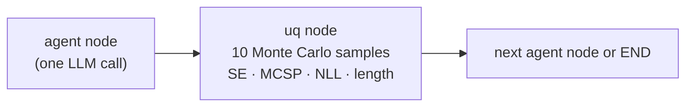
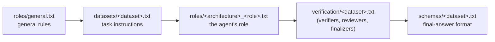

# Shared mechanics

What the feedback loop, Star and Sequential workflows (`spuma/agents/workflow/`) have in common.

**Model and sampling.** Every agent is Qwen2.5-7B-Instruct (bfloat16) served by an in-process vLLM engine
(context 32,768 tokens). Generation uses temperature 0.7, top-p 1.0 and at most 4,096 new tokens per response.

**Every response is measured right after it is generated.** Each agent node is followed by an uncertainty node
(`uq_<node>`) that draws 10 Monte Carlo samples from the same prompt and computes the response's
[SE, MCSP, NLL and length](../uncertainty/metrics.md). The measurement is written to the trajectory, never to the
conversation, so uncertainty cannot change what the agents see or when the workflow ends.

**Deterministic seeds.** A response's seed is a hash of (base seed 42, problem id, agent id, round). Each Monte Carlo
sample's seed adds the sample index. Reruns reproduce the same responses and samples, and no two calls share a
seed.

**Completion token.** `TASK_DONE` marks completion. It is removed from a response before that response is scored,
so it never affects an uncertainty value.

**Reference answers never reach an agent.** The workflow receives only the problem id and the agent-visible
problem text.

**Saved trajectory.** For every problem, `artifacts/<experiment>/generation-<fp>/trajectories/<problem>.json`
holds:
- every response in chronological order, with its agent, round/node, prompt, token ids and log-probabilities;
- its 10 samples and seeds, and its four metrics;
- the termination reason and the grade.

## Prompts

- **MATH:** the three MATH experiments define their prompts inline in their settings files.
- **MMLU, MuSiQue and MoreHopQA:** each agent's system prompt is composed from fragments in
  [`config/prompts/`](../../config/prompts), listed in the agent's `prompt:` setting and joined in order:

| Fragment | Content |
|---|---|
| `roles/general.txt` | act only in your own role, use only the given context, never access reference answers, follow the output format |
| `datasets/<dataset>.txt` | what the task is and how to reason about it |
| `roles/<architecture>_<role>.txt` | the agent's responsibilities and output structure (e.g. `VERDICT:` / `VERIFIED_ANSWER:` for verifiers) |
| `verification/<dataset>.txt` | dataset-specific checking and finalization rules |
| `schemas/<dataset>.txt` | the `REASONING:` / `ANSWER:` format the grader reads. The feedback-loop reviewer does not get it, because it reviews rather than answers |

The per-call user messages (`user_template`, and the Star coordinator's phase `templates`) are short templates in
the settings file. They're filled with `{problem}`, the earlier responses the agent is allowed to see, and nothing
else.
