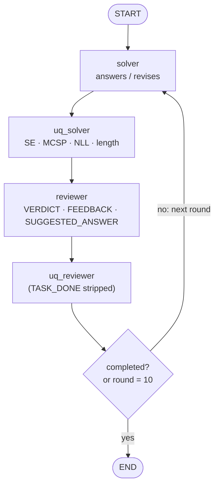

# Feedback loop

Two agents in an iterative role play (MATU / CAMEL style): the **solver** answers, the **reviewer** checks the answer
and gives feedback, and the solver revises. One round is one solver response followed by one reviewer response.

- **Implementation:** `spuma/agents/workflow/feedbackloop.py` (`FeedbackWorkflow`)
- **Settings:** `agents.workflow: feedback`, `agents.max_rounds: 10`, `agents.completion_token: TASK_DONE`
- **Agents:** the two enabled agents, in order: the solver, then the reviewer. In MATH they are the Master
  Mathematician and the Curious Math Enthusiast; in MMLU, MuSiQue and MoreHopQA, `solver` and `reviewer`.

## Graph

## What each agent sees

| Agent | Messages |
|---|---|
| Solver | its system prompt; its user template with the problem; then, alternately, its own earlier responses (as assistant messages) and each reviewer response verbatim (as user messages) |
| Reviewer | its system prompt; for each solver response, its user template filled with the problem and that solver response (user message); its own earlier reviews (assistant messages) |

## Termination

The loop ends after a reviewer turn when the **completion rule** holds, or after round 10:

| Datasets | Completion rule |
|---|---|
| MATH | the reviewer's response contains `TASK_DONE` |
| MMLU, MuSiQue, MoreHopQA | the reviewer's response contains `TASK_DONE` **and** matches `agents.completion_requires: 'VERDICT:\W*CORRECT\b'` |

On the question-answering datasets, a reviewer that reports `VERDICT: INCORRECT` or `UNCERTAIN` cannot end the
loop, even if it also writes `TASK_DONE`. The solver then sees the critique and revises. The number of such ignored
completion tokens is saved per trajectory (`metadata.ignored_completion_token`).

Termination reasons: `task_done` (the completion rule held) or `max_rounds`.

## Grading and seeds

- **Graded answer:** the solver's **last** response.
- **Seeds:** the round number is part of every seed, so each round's responses and samples get new seeds.

## Uncertainty features

See [uncertainty methods](../uncertainty/methods.md#feedback-loop). The feedback loop is the only architecture
with several responses per agent. Its SPN features aggregate each agent's responses over its rounds (RMS or
CHMM-weighted), giving 8 features.
