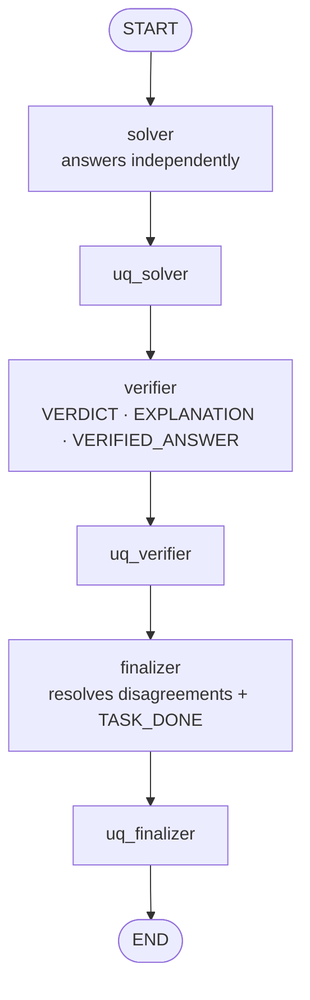

# Sequential (fixed, single pass)

A decentralized chain without a coordinator. A **solver** answers, a **verifier** checks the solver's answer, and
a **finalizer** reviews both and produces the final answer. Exactly three LLM calls per problem, with no loops or
routing.

- **Implementation:** `spuma/agents/workflow/sequential.py` (`MultiAgentWorkflow`)
- **Settings:** `agents.workflow: sequential`. Exactly three enabled agents, in order: solver, verifier, finalizer.
  In MATH they are `analyst`, `verifier`, `finalizer`; elsewhere `solver`, `verifier`, `finalizer`.

## Graph

## What each agent sees

Each agent gets its system prompt and **one** user message: its `user_template`, filled with:
- `{problem}`: the problem text;
- `{previous}`: the earlier agents' responses, in order, joined by a blank line;
- `{<agent id>}`: a specific earlier agent's response, e.g. `{solver}`.

| Agent | User message (MMLU, MuSiQue, MoreHopQA) |
|---|---|
| Solver | the problem |
| Verifier | the problem and the solver's full response |
| Finalizer | the problem, the solver's response and the verifier's assessment |

The finalizer is instructed not to trust either agent automatically, and to keep the solver's justified answer
when the verifier's correction is unsupported.

## Termination

The workflow always ends after the finalizer. Only the finalizer is asked to append `TASK_DONE`:
- **Termination reason:** `task_done` if it does, else `no_completion_token`.
- **Earlier `TASK_DONE`:** recorded (`metadata.early_completion_token`) and ignored.

## Grading and seeds

- **Graded answer:** the finalizer's response.
- **Seeds:** all three agents are round 1 and differ by agent id, so every call has its own seed.

## Uncertainty features

See [uncertainty methods](../uncertainty/methods.md#sequential). Each agent responds once, so nothing is averaged.
The SPN receives each agent's raw SE, MCSP, NLL and length (12 features).
