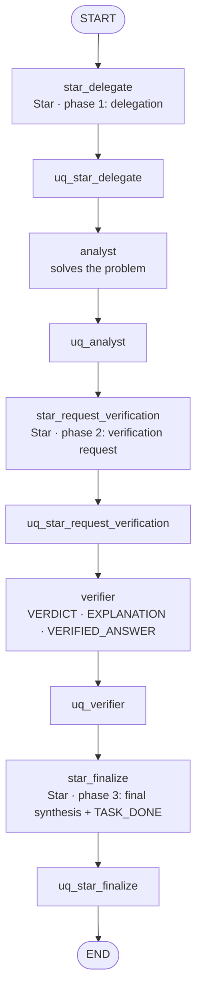

# Star (fixed, single pass)

A centralized architecture. A **Star coordinator** LLM delegates the problem to an **analyst**, forwards the
analyst's solution to a **verifier**, and synthesizes the final answer. The graph is fixed: no loops, no routing
decisions, exactly five LLM calls per problem.

- **Implementation:** `spuma/agents/workflow/star.py` (`StarWorkflow`)
- **Settings:** `agents.workflow: star`. Exactly three enabled agents, in order: coordinator (`star`), `analyst`,
  `verifier`. The coordinator must define the phase templates `delegation`, `verification_request` and
  `final_synthesis`.

## Graph

## The coordinator's three phases

The three Star calls share one system prompt. Each call adds the current phase's template, and the current phase
is stored in the graph state.

| Node | Phase | The coordinator is asked to |
|---|---|---|
| `star_delegate` | `delegation` | read the problem and ask the analyst for a complete solution, without solving it |
| `star_request_verification` | `verification_request` | summarize the analyst's solution faithfully and ask the verifier to check it, without correcting it |
| `star_finalize` | `final_synthesis` | weigh the solution and the assessment, give the final answer, end with `TASK_DONE` |

## What each agent sees

| Agent | Messages |
|---|---|
| Star coordinator | its system prompt, then, phase by phase, the phase template (user) and its own reply (assistant). The phase templates carry the problem (phase 1), the analyst's solution (phase 2) and the verifier's assessment (phase 3) |
| Analyst | its system prompt; one user message with the problem and the coordinator's delegation |
| Verifier | its system prompt; one user message with the problem, the analyst's solution and the coordinator's verification request |

## Termination

The workflow always ends after `star_finalize`. `TASK_DONE` is expected only in the final synthesis and never
changes the control flow:
- **Termination reason:** `task_done` if the final synthesis contains it, else `no_completion_token`.
- **Earlier `TASK_DONE`:** if an earlier node writes it, the node is recorded (`metadata.early_completion_token`)
  and ignored.

## Saved state, grading and seeds

- **Saved state:** besides the responses, each trajectory records the phase, the analyst's solution, the verifier's
  assessment, the final answer, completion status, and per-call prompt/completion token counts
  (`metadata.usage`, `metadata.llm_calls = 5`).
- **Graded answer:** the `star_finalize` response.
- **Seeds:** each response's `round` is its node's position (1–5), so the coordinator's three calls have distinct
  seeds.

## Uncertainty features

See [uncertainty methods](../uncertainty/methods.md#star). Every agent call happens exactly once, so nothing is
averaged. The SPN receives each of the five responses' raw SE, MCSP, NLL and length (20 features).
