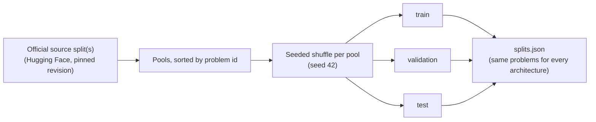

# Splits and grading

How every dataset is split, what agents see, and how answers are graded. Dataset-specific details are on each
dataset's page.

- **Splits.** Each of train, validation and test is drawn from a named official split (`dataset.split_sources`).
  Splits that share an official split take consecutive, disjoint slices of one seeded shuffle, so no problem is
  in two splits. The selection depends only on the seed and the problem ids, so all three architectures of a
  dataset use exactly the same problems. The selection is saved in `artifacts/<experiment>/splits.json`.
- **Visible vs private fields.** What the agents see is rendered into the problem text. Reference answers,
  aliases, decompositions and supporting-paragraph labels are kept in private fields that only the grader reads.
- **Standardized record.** `load_dataset_adapter(dataset_name, split, config, seed)` (`spuma/dataset/registry.py`)
  returns the selected examples of MMLU, MuSiQue and MoreHopQA as
  `{problem_id, dataset, question, choices, context, subject, answer_type, reference_answer, grading_metadata}`.
- **Grading.** After generation, the final answer of the graded response (see each architecture) is compared
  with the reference. The label is `wrong = 1`, `correct = 0`. A missing answer is graded wrong and flagged as a
  parse failure. A problem without a reference answer is recorded as unlabeled and is never graded.
- **Answer-aware equivalence.** The same answer extraction defines when two sampled responses agree for
  [semantic entropy](../uncertainty/metrics.md#semantic-entropy-se).
