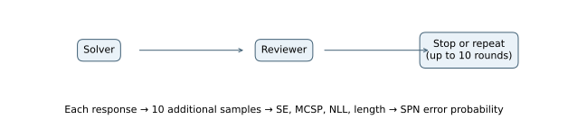
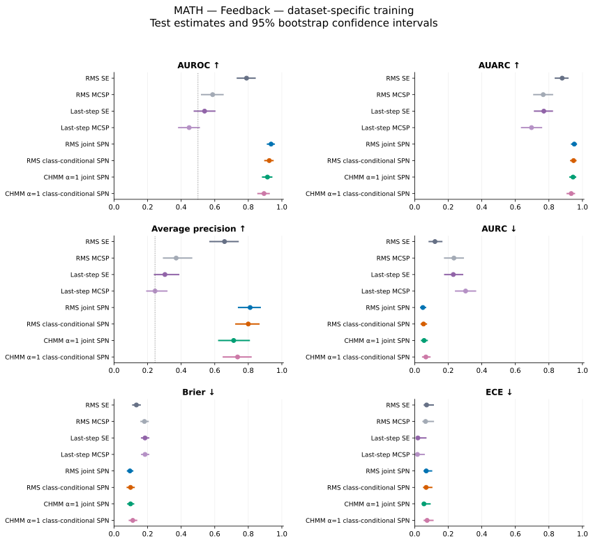
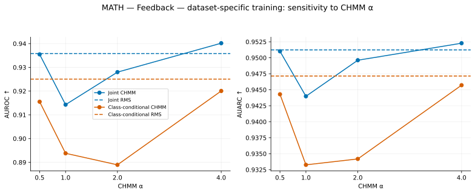

# MATH — Feedback — dataset-specific training

## Experimental setup

This experiment measures how well uncertainty scores identify incorrect final answers. The evaluated system answers **378 of 500 test problems correctly (75.60% accuracy)**. The positive class is an incorrect answer; its prevalence is **24.40%**.

MATH contains competition mathematics problems from seven subjects. Agents see the problem text. The final boxed answer is graded with Math-Verify. Training and validation use disjoint subsets of the official training split; testing uses the official test split.

The uncertainty models use 800 training problems and 200 validation problems. Test problems are held out from fitting and model selection.

All agents use Qwen2.5-7B-Instruct through vLLM with bfloat16 precision, temperature 0.7, top-p 1.0, up to 4,096 generated tokens, and a 32,768-token context window. The base seed is 42. Each observed response has ten additional samples from the same prompt. These samples measure uncertainty and do not enter the conversation.

## Architecture and uncertainty models

The solver and reviewer alternate for up to ten rounds. The final solver answer is graded. MATH stops when the reviewer emits TASK_DONE; the other datasets also require VERDICT: CORRECT. Each agent contributes four aggregated features, yielding eight SPN inputs.



Test conversations average **1.014 rounds**; 494 stop after one round and 0 reach ten rounds. A ten-round conversation does not by itself identify the stopping reason.

Each response contributes semantic entropy (SE), Monte Carlo sequence probability (MCSP), token negative log-likelihood (NLL), and length. SE measures disagreement among sampled meanings; MCSP averages length-normalized sequence probabilities. Standalone MCSP is negated so larger scores indicate greater error risk. RMS baselines pool all responses; last-step baselines use the chronologically last response.

RMS SPNs aggregate all four signals separately for each agent using root mean square. CHMM variants use a training-fitted three-state Gaussian HMM over question drift and interaction gap to weight responses. State coefficients are [1, 1+α, 1+2α], with α=1 primary and α∈{0.5,1,2,4} evaluated. The per-agent feature is (T/n_g)Σ w_t x_t. In this architecture, the last-step baseline measures the reviewer, while the final solver response is graded.

The joint SPN learns P(Z,Y) and estimates P(Y=1|Z). The class-conditional model learns separate feature densities for correct and incorrect answers and combines them with empirical training priors. Both use the same features. Forty-eight configurations vary leaf family, RDC threshold, minimum row slice, and leaf regularization; validation Brier score selects the model. Standardization uses training statistics. Frozen evaluations reuse the MATH-selected settings.

## Results

Higher AUROC, AUARC, and average precision are better; lower AURC, Brier, and ECE are better. **Bold** marks the best value and <u>underlining</u> marks the second-best distinct value within each table. Rankings use unrounded values and preserve ties. Brier and ECE use training-fitted logistic calibration for standalone scores and direct SPN probabilities. AUARC equals 1−AURC.

| Method | AUROC ↑ | AUARC ↑ | Average precision ↑ | AURC ↓ | Brier ↓ | ECE ↓ |
| --- | --- | --- | --- | --- | --- | --- |
| RMS SE | 0.7895 | 0.8791 | 0.6584 | 0.1209 | 0.1329 | 0.0711 |
| RMS MCSP | 0.5874 | 0.7662 | 0.3699 | 0.2338 | 0.1809 | 0.0649 |
| Last-step SE | 0.5395 | 0.7698 | 0.3030 | 0.2302 | 0.1843 | <u>0.0191</u> |
| Last-step MCSP | 0.4475 | 0.6965 | 0.2441 | 0.3035 | 0.1843 | **0.0167** |
| RMS joint SPN | **0.9358** | **0.9512** | **0.8109** | **0.0488** | **0.0946** | 0.0689 |
| RMS class-conditional SPN | <u>0.9250</u> | <u>0.9471</u> | <u>0.7998</u> | <u>0.0529</u> | <u>0.0981</u> | 0.0683 |
| CHMM α=1 joint SPN | 0.9143 | 0.9440 | 0.7128 | 0.0560 | 0.0981 | 0.0553 |
| CHMM α=1 class-conditional SPN | 0.8938 | 0.9333 | 0.7361 | 0.0667 | 0.1114 | 0.0740 |



Points show test estimates; bars show 95% percentile intervals from 10,000 paired bootstrap resamples of test problems. The dotted AUROC line marks 0.5; the dotted average-precision line marks error prevalence. Intervals describe test-sampling variation for fitted models and do not include variation across training seeds.

### Comparison with semantic entropy and answer accuracy

The joint SPN has AUROC **0.9358**, compared with **0.7895** for RMS SE, a difference of **+0.1463**. The class-conditional counterpart has AUROC **0.9250**, a difference of **-0.0108** relative to the joint model. These are point differences; a larger point estimate alone does not establish a reliable improvement.

For selective prediction, joint-SPN AURC is 0.0488, compared with 0.1209 for RMS SE. Brier scores are 0.0946 and 0.1329, respectively. Error ranking, selective risk, and probability calibration therefore need to be assessed separately.

Answer accuracy is 75.60%, leaving 378 correct and 122 incorrect test examples. Accuracy describes the generated answers; AUROC describes separation between correct and incorrect answers. This experiment alone does not establish that task difficulty causes a change in SPN performance. Average precision should be read against the 24.40% error prevalence.

At the primary CHMM setting, joint-SPN AUROC is 0.9143, a difference of -0.0215 from RMS aggregation. CHMM and RMS differ in their aggregation rule as well as in their response weights.

### CHMM sensitivity

| Method | AUROC ↑ | AUARC ↑ | Average precision ↑ | AURC ↓ | Brier ↓ | ECE ↓ |
| --- | --- | --- | --- | --- | --- | --- |
| RMS joint SPN | <u>0.9358</u> | <u>0.9512</u> | <u>0.8109</u> | <u>0.0488</u> | <u>0.0946</u> | 0.0689 |
| RMS class-conditional SPN | 0.9250 | 0.9471 | 0.7998 | 0.0529 | 0.0981 | 0.0683 |
| CHMM α=0.5 joint SPN | 0.9355 | 0.9510 | **0.8162** | 0.0490 | 0.0948 | 0.0861 |
| CHMM α=0.5 class-conditional SPN | 0.9155 | 0.9443 | 0.7271 | 0.0557 | 0.1056 | 0.0711 |
| CHMM α=1 joint SPN | 0.9143 | 0.9440 | 0.7128 | 0.0560 | 0.0981 | **0.0553** |
| CHMM α=1 class-conditional SPN | 0.8938 | 0.9333 | 0.7361 | 0.0667 | 0.1114 | 0.0740 |
| CHMM α=2 joint SPN | 0.9280 | 0.9496 | 0.7519 | 0.0504 | 0.0952 | <u>0.0620</u> |
| CHMM α=2 class-conditional SPN | 0.8889 | 0.9342 | 0.7124 | 0.0658 | 0.1210 | 0.0838 |
| CHMM α=4 joint SPN | **0.9402** | **0.9523** | 0.8012 | **0.0477** | **0.0854** | 0.0679 |
| CHMM α=4 class-conditional SPN | 0.9200 | 0.9457 | 0.7475 | 0.0543 | 0.1009 | 0.0691 |



Alpha=1 remains the primary setting; the displayed test results are not used to select alpha.

### Posterior-entropy scores

These scores use h(p)=−p ln(p)−(1−p)ln(1−p), which is largest near p=0.5. They rank uncertainty about the correctness label rather than error probability. Only ranking measures are reported.

| Method | AUROC ↑ | AUARC ↑ | Average precision ↑ | AURC ↓ |
| --- | --- | --- | --- | --- |
| RMS joint SPN — entropy | **0.8814** | **0.9390** | 0.5536 | **0.0610** |
| CHMM α=0.5 joint SPN — entropy | 0.8641 | 0.9349 | 0.5202 | 0.0651 |
| CHMM α=1 joint SPN — entropy | 0.8678 | 0.9327 | <u>0.5786</u> | 0.0673 |
| CHMM α=2 joint SPN — entropy | <u>0.8681</u> | <u>0.9352</u> | 0.5655 | <u>0.0648</u> |
| CHMM α=4 joint SPN — entropy | 0.8595 | 0.9318 | **0.5866** | 0.0682 |
| RMS class-conditional SPN — entropy | 0.6920 | 0.8001 | 0.4043 | 0.1999 |
| CHMM α=0.5 class-conditional SPN — entropy | 0.7911 | 0.8823 | 0.5272 | 0.1177 |
| CHMM α=1 class-conditional SPN — entropy | 0.7608 | 0.8711 | 0.5016 | 0.1289 |
| CHMM α=2 class-conditional SPN — entropy | 0.7893 | 0.8993 | 0.4991 | 0.1007 |
| CHMM α=4 class-conditional SPN — entropy | 0.7163 | 0.8312 | 0.4250 | 0.1688 |

## Prompts used

System instructions and user-message templates are reproduced verbatim below. Braced placeholders are filled with the problem and the earlier responses available to the agent. Feedback also includes conversation history. Frozen models use these same target-task prompts.

### Mathematician

System prompt:

```text
You are the Master Mathematician, an expert in mathematical problem-solving. Solve problems accurately, explain your reasoning clearly, and respond to the Curious Math Enthusiast's questions and feedback. Correct mistakes when necessary, maintain conversation context, and present final answers using \boxed{} when appropriate.
```

User-message template:

```text
Solve the following mathematical problem:

{problem}
```

### Enthusiast

System prompt:

```text
You are the Curious Math Enthusiast, collaborating with the Master Mathematician. Carefully examine mathematical solutions, ask relevant questions, request clarifications, and provide constructive feedback. Do not solve the problem yourself. When the solution is sufficiently complete and convincing, end your response with TASK_DONE. Otherwise, continue the discussion naturally.
```

User-message template:

```text
Original mathematical problem:
{problem}

Latest response from the Master Mathematician:
{previous}

Review the response and provide your next question or feedback. If the solution is complete, end with TASK_DONE.
```
