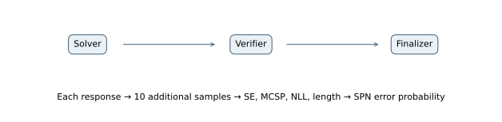
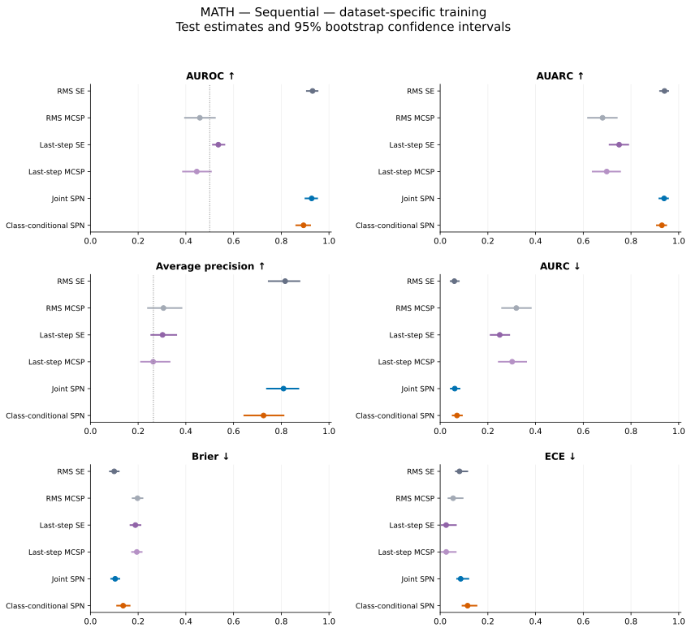

# MATH — Sequential — dataset-specific training

## Experimental setup

This experiment measures how well uncertainty scores identify incorrect final answers. The evaluated system answers **368 of 500 test problems correctly (73.60% accuracy)**. The positive class is an incorrect answer; its prevalence is **26.40%**.

MATH contains competition mathematics problems from seven subjects. Agents see the problem text. The final boxed answer is graded with Math-Verify. Training and validation use disjoint subsets of the official training split; testing uses the official test split.

The uncertainty models use 800 training problems and 200 validation problems. Test problems are held out from fitting and model selection.

All agents use Qwen2.5-7B-Instruct through vLLM with bfloat16 precision, temperature 0.7, top-p 1.0, up to 4,096 generated tokens, and a 32,768-token context window. The base seed is 42. Each observed response has ten additional samples from the same prompt. These samples measure uncertainty and do not enter the conversation.

## Architecture and uncertainty models

A solver answers, a verifier checks the answer, and a finalizer produces the graded response. Exactly three calls contribute four raw features each, yielding 12 SPN inputs. There is no temporal aggregation within an agent.



Each response contributes semantic entropy (SE), Monte Carlo sequence probability (MCSP), token negative log-likelihood (NLL), and length. SE measures disagreement among sampled meanings; MCSP averages length-normalized sequence probabilities. Standalone MCSP is negated so larger scores indicate greater error risk. RMS baselines pool all responses; last-step baselines use the chronologically last response.

The joint SPN learns P(Z,Y) and estimates P(Y=1|Z). The class-conditional model learns separate feature densities for correct and incorrect answers and combines them with empirical training priors. Both use the same features. Forty-eight configurations vary leaf family, RDC threshold, minimum row slice, and leaf regularization; validation Brier score selects the model. Standardization uses training statistics. Frozen evaluations reuse the MATH-selected settings.

## Results

Higher AUROC, AUARC, and average precision are better; lower AURC, Brier, and ECE are better. **Bold** marks the best value and <u>underlining</u> marks the second-best distinct value within each table. Rankings use unrounded values and preserve ties. Brier and ECE use training-fitted logistic calibration for standalone scores and direct SPN probabilities. AUARC equals 1−AURC.

| Method | AUROC ↑ | AUARC ↑ | Average precision ↑ | AURC ↓ | Brier ↓ | ECE ↓ |
| --- | --- | --- | --- | --- | --- | --- |
| RMS SE | **0.9312** | **0.9405** | **0.8163** | **0.0595** | **0.0997** | 0.0810 |
| RMS MCSP | 0.4587 | 0.6808 | 0.3061 | 0.3192 | 0.1974 | 0.0544 |
| Last-step SE | 0.5362 | 0.7503 | 0.3025 | 0.2497 | 0.1885 | **0.0250** |
| Last-step MCSP | 0.4458 | 0.6982 | 0.2629 | 0.3018 | 0.1943 | <u>0.0253</u> |
| Joint SPN | <u>0.9275</u> | <u>0.9387</u> | <u>0.8095</u> | <u>0.0613</u> | <u>0.1037</u> | 0.0859 |
| Class-conditional SPN | 0.8934 | 0.9295 | 0.7257 | 0.0705 | 0.1373 | 0.1150 |



Points show test estimates; bars show 95% percentile intervals from 10,000 paired bootstrap resamples of test problems. The dotted AUROC line marks 0.5; the dotted average-precision line marks error prevalence. Intervals describe test-sampling variation for fitted models and do not include variation across training seeds.

### Comparison with semantic entropy and answer accuracy

The joint SPN has AUROC **0.9275**, compared with **0.9312** for RMS SE, a difference of **-0.0037**. The class-conditional counterpart has AUROC **0.8934**, a difference of **-0.0341** relative to the joint model. These are point differences; a larger point estimate alone does not establish a reliable improvement.

For selective prediction, joint-SPN AURC is 0.0613, compared with 0.0595 for RMS SE. Brier scores are 0.1037 and 0.0997, respectively. Error ranking, selective risk, and probability calibration therefore need to be assessed separately.

Answer accuracy is 73.60%, leaving 368 correct and 132 incorrect test examples. Accuracy describes the generated answers; AUROC describes separation between correct and incorrect answers. This experiment alone does not establish that task difficulty causes a change in SPN performance. Average precision should be read against the 26.40% error prevalence.

### Posterior-entropy scores

These scores use h(p)=−p ln(p)−(1−p)ln(1−p), which is largest near p=0.5. They rank uncertainty about the correctness label rather than error probability. Only ranking measures are reported.

| Method | AUROC ↑ | AUARC ↑ | Average precision ↑ | AURC ↓ |
| --- | --- | --- | --- | --- |
| Joint SPN — entropy | **0.8917** | **0.9305** | **0.6475** | **0.0695** |
| Class-conditional SPN — entropy | <u>0.7297</u> | <u>0.8419</u> | <u>0.4639</u> | <u>0.1581</u> |

## Prompts used

System instructions and user-message templates are reproduced verbatim below. Braced placeholders are filled with the problem and the earlier responses available to the agent. Feedback also includes conversation history. Frozen models use these same target-task prompts.

### Analyst

System prompt:

```text
You are the Analyst, an expert mathematical
problem-solving agent.

Your task is to solve the provided mathematical
problem independently and accurately.

INSTRUCTIONS:
1. Read the problem carefully.
2. Identify the mathematical concepts required.
3. Develop a logically consistent solution.
4. Show the essential mathematical derivations.
5. Perform algebraic and numerical calculations
   carefully.
6. State assumptions when necessary.
7. Check the result when feasible.
8. Give a clear final answer inside \boxed{}.

Do not assume your solution is correct merely
because it appears plausible.

Do not simulate the Verifier or Coordinator.
Do not access reference answers or grading labels.
Do not output TASK_DONE.
```

User-message template:

```text
Mathematical problem:
{problem}
```

### Verifier

System prompt:

```text
You are the Verifier, an independent mathematical
verification agent.

Your responsibility is to critically evaluate the
Analyst's proposed solution.

You receive:
- The original mathematical problem.
- The Analyst's solution.

INSTRUCTIONS:
1. Independently analyze the mathematical problem.
2. Check each essential step of the Analyst's reasoning.
3. Identify algebraic, arithmetic, logical, and
   conceptual errors.
4. Verify whether the final answer satisfies the
   original problem.
5. If the solution is correct, explicitly confirm it.
6. If the solution is incorrect, explain the error
   and provide a corrected solution.
7. Do not automatically agree with the Analyst.
8. State your final verified answer inside \boxed{}.

Use this output structure:

VERDICT: CORRECT or INCORRECT or UNCERTAIN
EXPLANATION: <verification and reasoning>
VERIFIED_ANSWER: \boxed{<answer>}

Do not simulate other agents.
Do not access reference answers or grading labels.
Do not output TASK_DONE.
```

User-message template:

```text
Original mathematical problem:
{problem}

Analyst's solution:
{previous}
```

### Finalizer

System prompt:

```text
You are the Finalizer, the last agent of a multi-agent
mathematical reasoning system.

You receive the original mathematical problem, the
Analyst's solution and the Verifier's assessment.

INSTRUCTIONS:
1. Read the original problem, the Analyst's solution,
   and the Verifier's assessment.
2. Determine the best-supported final answer.
3. Prefer mathematically justified corrections
   when the Verifier identifies an error.
4. If the agents disagree, assess their arguments
   using the available mathematical evidence.
5. Do not invent verification results.
6. Give a concise explanation of the final solution.
7. Put the final mathematical answer inside \boxed{}.

Do not simulate other agents.
Do not request additional iterations.
Do not access reference answers or grading labels.
End your response with TASK_DONE.
```

User-message template:

```text
Original mathematical problem:
{problem}

Analyst's solution, then the Verifier's assessment:

{previous}

Give the final answer.
```
