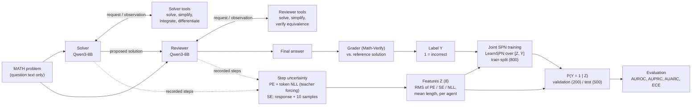
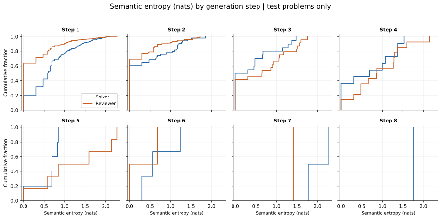
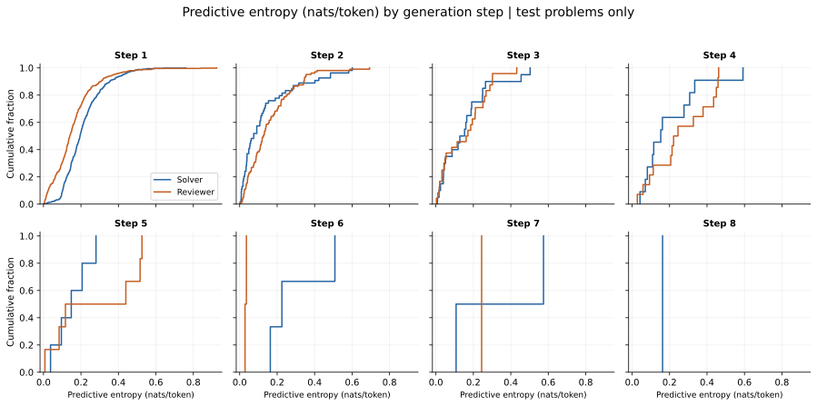
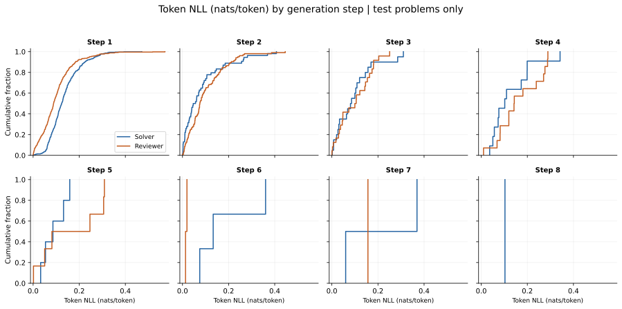
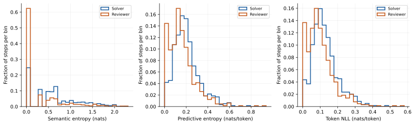
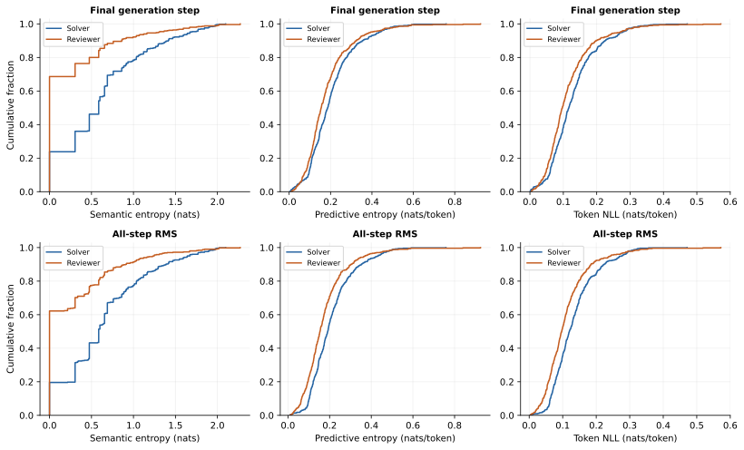
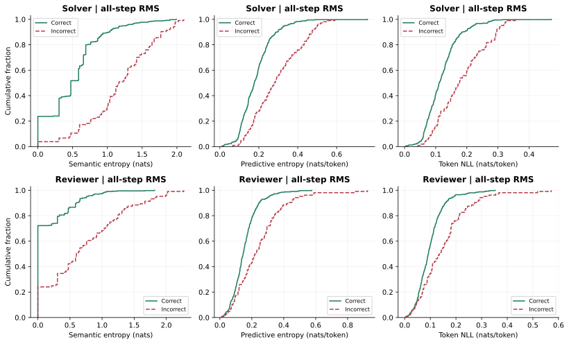

# MATH: Qwen3-8B Solver–Reviewer experiment

This experiment measures whether uncertainty recorded during a two-agent mathematical
question-answering workflow predicts an incorrect final answer. A joint sum-product
network (SPN) learns the relationship between uncertainty features and final-answer
correctness. It scores completed trajectories; it does not revise the agents' answers.

The registered experiment is `math`, defined in
[`spuma/experiments/math.py`](../../spuma/experiments/math.py), with settings in
[`config/config-qwen-math.yaml`](../../config/config-qwen-math.yaml).
Its artifact directory is `artifacts/ma_qwen_math/`.

## Dataset and splits

The code loads `EleutherAI/hendrycks_math` from Hugging Face, covering algebra,
counting and probability, geometry, intermediate algebra, number theory,
prealgebra, and precalculus. The experiment uses 1,500 problems:

| Experimental split | Problems | Official source split |
|---|---:|---|
| Training | 800 | Train |
| Validation | 200 | Train |
| Test | 500 | Test |

Training and validation are disjoint. Selection sorts stable problem identifiers
before shuffling with seed 42. Training fits the error-prediction model; the language
model is not fine-tuned. Reference solutions are available only to the evaluator.

## Agents and tools

LangGraph runs the agents sequentially. Both use `Qwen/Qwen3-8B` with thinking mode
disabled. The Solver receives the problem and produces a proposed solution. The
Reviewer receives the problem and the Solver's final message, checks the reasoning,
and produces the answer used for grading. Both are instructed to put their final
answer in `\boxed{}`.

| Agent | Available tools |
|---|---|
| Solver | `sympy_solve`, `sympy_simplify`, `sympy_integrate`, `sympy_differentiate` |
| Reviewer | `sympy_solve`, `sympy_simplify`, `math_verify` |

Each agent has up to eight generation steps and five attempted tool calls. Tool
results and errors return to the requesting agent as observations. A step is one
model generation, rather than an individual sentence or mathematical operation.
Tool access does not imply tool use on every problem.

## Generation and uncertainty

| Setting | Value |
|---|---|
| Generation backend | vLLM |
| PE and token-NLL scoring backend | Transformers |
| Arithmetic | bfloat16 |
| Temperature / top-p | 0.7 / 0.9 |
| Top-k truncation | Disabled |
| Maximum new tokens | 2,048 per generation |
| Context limit | 8,192 tokens |
| Tensor-parallel shards | 1 |
| Concurrent problems | 8 |
| Seed | 42 |

Transformers teacher-forces the saved prompt and continuation token IDs to score
the actual generated response. PE and token NLL use the raw model distribution,
before temperature scaling or sampling truncation. All logarithms are natural.

- **Predictive entropy (PE):** mean full-vocabulary next-token entropy across
  generated tokens.
- **Token negative log-likelihood (NLL):** mean negative log probability of the
  actual generated tokens.
- **Semantic entropy (SE):** entropy of semantic clusters formed from the recorded
  response and ten additional responses sampled from the same frozen pre-step
  context. Tool requests in these alternatives are kept as text and never executed.
- **Token length:** number of generated tokens in the step.

SE uses UQLM with an answer-aware comparison. When both responses have boxed
answers, normalized equality or Math-Verify checks their equivalence. When only one
has a boxed answer, they differ. When neither has a boxed answer, comparison falls
back to `tasksource/ModernBERT-large-nli`, accepting entailment in either direction.
The NLI limits are 8,000 characters per text and 2,048 tokens per pair, with batch
size 32. Reference answers do not enter semantic clustering.

## Features, target, and joint SPN

For each agent, PE, SE, and token NLL are aggregated across its steps using root
mean square, `sqrt(mean(step_score ** 2))`. Token length uses an arithmetic mean.
The joint SPN receives these eight features in order:

```text
solver_pe, solver_se, solver_nll, solver_length,
reviewer_pe, reviewer_se, reviewer_nll, reviewer_length
```

The target is `Y = 1` for an incorrect Reviewer answer and `Y = 0` for a correct
answer. The evaluator extracts the last boxed answer and compares it with the
reference using Math-Verify. Missing boxed answers count as incorrect and are
flagged as parse failures. If the reference cannot be parsed, grading falls back
to normalized string equality.

The model learns a joint density over features `Z` and label `Y`, then predicts:

```text
P(Y = 1 | Z) = P(Z, Y = 1) / (P(Z, Y = 0) + P(Z, Y = 1))
```

SPFlow's LearnSPN uses two-way clustering, minimum row slice 50, minimum feature
slice 2, and RDC threshold 0.3. Continuous leaves use ten uniform bins derived from
training data, two exponential tails, and smoothing 1. Label leaves are binary
indicators with smoothing 1. A varying label cannot be split into an independent
product block by itself. Standardization uses training statistics only; validation
and test data are excluded from fitting.

## Running

Run commands from the repository root after completing the setup in the
[README](../../README.md#setup). Full generation requires Linux and an NVIDIA GPU
with vLLM installed. CPU and Apple Silicon support development and offline tests.

In `config/config-qwen-math.yaml`, set `evaluation.risk_models` to select only the
joint SPN for the commands in this document:

```yaml
evaluation:
  risk_models: [spn]
```

Keep the other evaluation settings. Set this list in the YAML file because
environment list overrides are merged with the configured list.

Run a smoke experiment or the complete experiment:

```bash
scripts/run-experiments.sh --experiment math --limit 5
scripts/run-experiments.sh --experiment math
```

`--limit 5` uses five problems per split and does not reproduce the reported results.
The phases are `generate`, `score`, `train`, and `evaluate`, in that order. Reuse
saved generations or fitted features by selecting phases:

```bash
scripts/run-experiments.sh --experiment math --phase score --phase train --phase evaluate
scripts/run-experiments.sh --experiment math --phase train --phase evaluate
```

The runner releases vLLM before loading Transformers for scoring. On a single GPU,
the phases can also run in separate processes:

```bash
scripts/run-experiments.sh --experiment math --phase generate
scripts/run-experiments.sh --experiment math --phase score --phase train --phase evaluate
```

Resume is enabled. Generation and scoring settings determine artifact fingerprints.
Outputs include split assignments, sanitized settings, trajectories, tool records,
per-step metrics, feature vectors, fitted models, and `evaluation.json`. Logs are
written to `logs/` and the console.

## Report figures

The following seven figures appear in the report in this order. Distribution plots
use the 500 test problems. Blue represents Solver and orange represents Reviewer,
except in Figure 7, where colors identify final-answer correctness.

For a cumulative distribution (ECDF), the horizontal axis is the uncertainty score
and the vertical axis is the fraction of observations at or below that score. For
example, a height of 0.8 at a score of 0.5 means 80% of observations score at most
0.5. A curve farther left generally indicates lower scores. SE is measured in
nats; PE and token NLL are measured in nats per generated token.

### Figure 1: Workflow and uncertainty analysis



Read the upper path from left to right: the problem goes to the Solver, its proposed
solution goes to the Reviewer, and the Reviewer supplies the final answer. Each
agent has a local tool-request and observation loop. Solid arrows represent executed
workflow operations; dashed arrows pass recorded generations and frozen contexts to
uncertainty analysis.

The lower path computes step-level PE, SE, and token NLL and aggregates eight
features `Z`. The joint SPN is fitted on `[Z, Y]` for the 800 training problems only;
for validation and test problems it receives `Z` alone and predicts `P(Y = 1 | Z)`,
the probability of an incorrect final answer, which the evaluation scores against
the graded labels. Reference solutions are used only for grading and do not enter
either agent's context.

### Figure 2: Semantic entropy by generation step



[PDF version](assets/math_ma_qwen3_8b/steps_se.pdf)

Each panel represents one generation position, from step 1 to step 8. Its horizontal
axis is SE and its vertical axis is the cumulative fraction within that agent and
position. SE measures disagreement among the actual response and ten sampled
alternatives. A vertical jump at zero means that many response sets were grouped
into a single semantic cluster. A curve extending farther right indicates greater
disagreement among meanings.

Only trajectories reaching a position contribute to its panel. Missing later steps
are not zero scores, and an absent curve means no observations for that role.
Changes across positions therefore do not establish that extra reasoning or tools
reduce uncertainty on the same problems. Zero SE can also occur for incorrect answers.

### Figure 3: Predictive entropy by generation step



[PDF version](assets/math_ma_qwen3_8b/steps_pe.pdf)

Panels again correspond to generation positions. The horizontal axis is mean
full-vocabulary next-token entropy along the actual continuation; the vertical axis
is the cumulative fraction. A curve farther right indicates that the raw model
spreads its next-token probability over more alternatives. This can reflect wording
choices as well as mathematical uncertainty.

Compare Solver and Reviewer within a panel to see their token-level uncertainty at
the same generation position. Later positions contain a selected subset of problems,
so the panels do not track a fixed cohort improving over time.

### Figure 4: Token NLL by generation step



[PDF version](assets/math_ma_qwen3_8b/steps_nll.pdf)

The horizontal axis is the average negative log probability of the actual generated
tokens, and the vertical axis is the cumulative fraction. Larger values mean that
the realized continuation was less probable under the raw model. PE averages over
all vocabulary choices; NLL scores only the tokens that occurred.

The plot describes the model's own continuations, not reference-solution likelihood
or the SPN's training loss. As in Figures 2 and 3, later-step cohorts differ and an
absent curve means no observations.

### Figure 5: All observed steps pooled



[PDF version](assets/math_ma_qwen3_8b/pooled_steps.pdf)

The three panels show SE, PE, and token NLL after pooling every observed test step
within each role. The horizontal axes contain score intervals; the vertical axis
is the fraction of that role's steps in each bin. Each role's bin heights sum to
one. Taller bins identify more common score ranges. The first SE bin includes exact
zeros and nearby small values.

This figure summarizes generation behavior across steps. A problem with more steps
contributes more observations, so these are not equally weighted problem-level
distributions or the aggregated inputs used by the SPN. Compare roles within a
metric; numerical magnitudes across different metrics have different meanings.

### Figure 6: Final steps versus all-step RMS



[PDF version](assets/math_ma_qwen3_8b/completed_trajectories.pdf)

Columns show SE, PE, and token NLL. The top row uses each agent's last generated
step; the bottom row uses RMS across all of its steps. Both rows give each test
problem one observation per role. Horizontal axes show the scores and vertical
axes show cumulative fractions. The bottom row displays the uncertainty features
actually supplied to the joint SPN. RMS preserves the influence of high-scoring
earlier steps that a final-step summary can hide.

Mean RMS SE is 0.645 nats for Solver and 0.274 for Reviewer. Zero RMS SE occurs for
19.6% of Solver trajectories and 62.2% of Reviewer trajectories; because SE is
nonnegative, zero RMS means every observed step had zero SE. The Reviewer has a
different prompt, context, and tool set, so lower uncertainty does not isolate a
causal benefit of reviewing. The Solver's final generation can be a tool request
stopped by a budget limit, rather than a completed answer.

### Figure 7: Uncertainty by final-answer correctness



[PDF version](assets/math_ma_qwen3_8b/outcomes.pdf)

Rows show Solver and Reviewer; columns show SE, PE, and token NLL. Green solid
curves represent correct final Reviewer answers and red dashed curves represent
incorrect ones. The horizontal axes contain RMS uncertainty scores; the vertical
axes contain cumulative fractions normalized separately within each correctness
group. A red curve farther right indicates larger scores among incorrect answers.
Both agents are grouped by the final Reviewer's correctness, not by separately
grading each agent's intermediate responses.

Incorrect answers have higher mean uncertainty for every role and metric. For
example, Solver RMS SE averages 0.505 nats for correct answers and 1.177 for incorrect
answers; Reviewer values are 0.158 and 0.717. The overlapping distributions show
that uncertainty alone cannot perfectly separate correct and incorrect answers.
Curve height does not indicate group size: there are 396 correct and 104 incorrect
test answers. These associations do not establish how much each feature contributes
to the jointly fitted SPN.

## Reported results

The report presents joint-SPN AUROC and AUPRC point estimates. An incorrect answer
is the positive class; larger scores indicate greater error risk.

| Split | AUROC | AUPRC |
|---|---:|---:|
| Validation | 0.864 | 0.709 |
| Test | 0.888 | 0.739 |

The Reviewer answers 396 of 500 test problems correctly: accuracy is 79.2% and error
prevalence is 20.8%. There are 22 test answers without an extractable boxed answer;
they remain in the analysis as incorrect. Validation accuracy is 75.0%.

For the joint SPN, ranking test answers by binary posterior entropy instead of
error probability gives AUROC 0.870 and AUPRC 0.566. Posterior entropy peaks near
error probability 0.5, so confident errors can receive low entropy.

The configured evaluator also supports calibration metrics and 1,000 bootstrap
iterations at 95% confidence; the report's tables present AUROC and AUPRC point
estimates only. Low response uncertainty does not establish mathematical correctness.
The model and tokenizer revisions are unpinned, so rerunning with later Hub revisions
may change outputs. These reported values describe the saved evaluation, not a new
run performed while writing this document.
