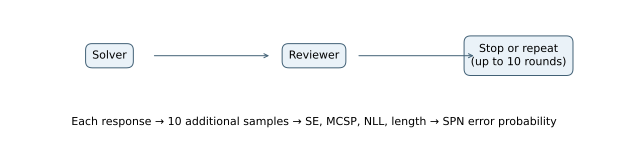
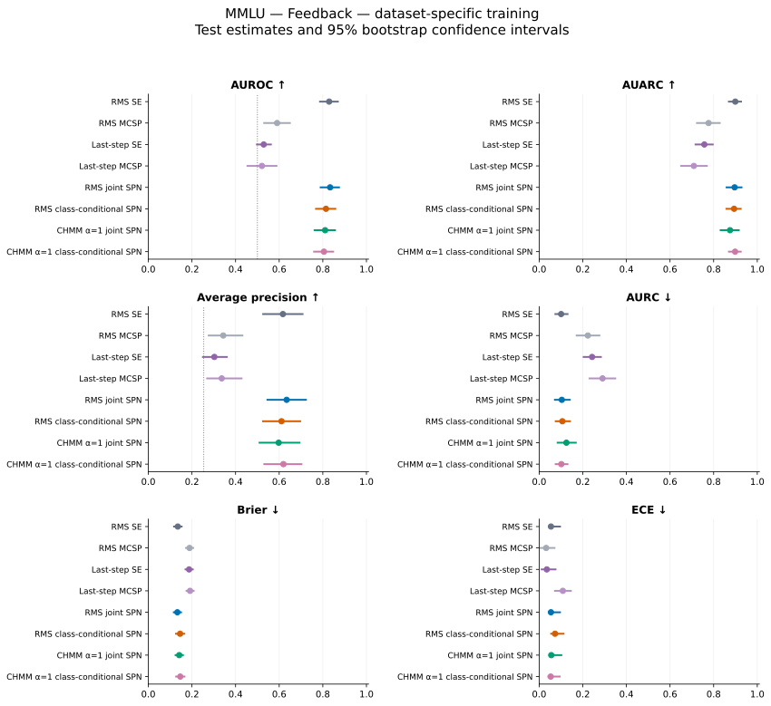
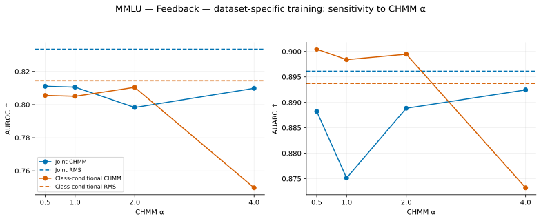

# MMLU — Feedback — dataset-specific training

## Experimental setup

This experiment measures how well uncertainty scores identify incorrect final answers. The evaluated system answers **373 of 500 test problems correctly (74.60% accuracy)**. The positive class is an incorrect answer; its prevalence is **25.40%**.

MMLU provides academic questions with four answer choices. The final answer letter is compared with the reference. Training uses official validation, validation uses official dev, and testing uses official test.

The uncertainty models use 800 training problems and 200 validation problems. Test problems are held out from fitting and model selection.

All agents use Qwen2.5-7B-Instruct through vLLM with bfloat16 precision, temperature 0.7, top-p 1.0, up to 4,096 generated tokens, and a 32,768-token context window. The base seed is 42. Each observed response has ten additional samples from the same prompt. These samples measure uncertainty and do not enter the conversation.

## Architecture and uncertainty models

The solver and reviewer alternate for up to ten rounds. The final solver answer is graded. MATH stops when the reviewer emits TASK_DONE; the other datasets also require VERDICT: CORRECT. Each agent contributes four aggregated features, yielding eight SPN inputs.



Test conversations average **1.210 rounds**; 432 stop after one round and 1 reach ten rounds. A ten-round conversation does not by itself identify the stopping reason.

Each response contributes semantic entropy (SE), Monte Carlo sequence probability (MCSP), token negative log-likelihood (NLL), and length. SE measures disagreement among sampled meanings; MCSP averages length-normalized sequence probabilities. Standalone MCSP is negated so larger scores indicate greater error risk. RMS baselines pool all responses; last-step baselines use the chronologically last response.

RMS SPNs aggregate all four signals separately for each agent using root mean square. CHMM variants use a training-fitted three-state Gaussian HMM over question drift and interaction gap to weight responses. State coefficients are [1, 1+α, 1+2α], with α=1 primary and α∈{0.5,1,2,4} evaluated. The per-agent feature is (T/n_g)Σ w_t x_t. In this architecture, the last-step baseline measures the reviewer, while the final solver response is graded.

The joint SPN learns P(Z,Y) and estimates P(Y=1|Z). The class-conditional model learns separate feature densities for correct and incorrect answers and combines them with empirical training priors. Both use the same features. Forty-eight configurations vary leaf family, RDC threshold, minimum row slice, and leaf regularization; validation Brier score selects the model. Standardization uses training statistics.

## Results

Higher AUROC, AUARC, and average precision are better; lower AURC, Brier, and ECE are better. **Bold** marks the best value and <u>underlining</u> marks the second-best distinct value within each table. Rankings use unrounded values and preserve ties. Brier and ECE use training-fitted logistic calibration for standalone scores and direct SPN probabilities. AUARC equals 1−AURC.

| Method | AUROC ↑ | AUARC ↑ | Average precision ↑ | AURC ↓ | Brier ↓ | ECE ↓ |
| --- | --- | --- | --- | --- | --- | --- |
| RMS SE | <u>0.8290</u> | **0.8992** | 0.6170 | **0.1008** | <u>0.1350</u> | 0.0542 |
| RMS MCSP | 0.5903 | 0.7768 | 0.3434 | 0.2232 | 0.1889 | **0.0320** |
| Last-step SE | 0.5290 | 0.7573 | 0.3027 | 0.2427 | 0.1870 | <u>0.0351</u> |
| Last-step MCSP | 0.5206 | 0.7093 | 0.3366 | 0.2907 | 0.1913 | 0.1086 |
| RMS joint SPN | **0.8334** | 0.8961 | **0.6341** | 0.1039 | **0.1331** | 0.0541 |
| RMS class-conditional SPN | 0.8144 | 0.8937 | 0.6105 | 0.1063 | 0.1455 | 0.0728 |
| CHMM α=1 joint SPN | 0.8105 | 0.8751 | 0.5975 | 0.1249 | 0.1417 | 0.0554 |
| CHMM α=1 class-conditional SPN | 0.8050 | <u>0.8984</u> | <u>0.6194</u> | <u>0.1016</u> | 0.1464 | 0.0529 |



Points show test estimates; bars show 95% percentile intervals from 10,000 paired bootstrap resamples of test problems. The dotted AUROC line marks 0.5; the dotted average-precision line marks error prevalence. Intervals describe test-sampling variation for fitted models and do not include variation across training seeds.

### Comparison with semantic entropy and answer accuracy

The joint SPN has AUROC **0.8334**, compared with **0.8290** for RMS SE, a difference of **+0.0044**. The class-conditional counterpart has AUROC **0.8144**, a difference of **-0.0190** relative to the joint model. These are point differences; a larger point estimate alone does not establish a reliable improvement.

For selective prediction, joint-SPN AURC is 0.1039, compared with 0.1008 for RMS SE. Brier scores are 0.1331 and 0.1350, respectively. Error ranking, selective risk, and probability calibration therefore need to be assessed separately.

Answer accuracy is 74.60%, leaving 373 correct and 127 incorrect test examples. Accuracy describes the generated answers; AUROC describes separation between correct and incorrect answers. This experiment alone does not establish that task difficulty causes a change in SPN performance. Average precision should be read against the 25.40% error prevalence.

At the primary CHMM setting, joint-SPN AUROC is 0.8105, a difference of -0.0229 from RMS aggregation. CHMM and RMS differ in their aggregation rule as well as in their response weights.

### CHMM sensitivity

| Method | AUROC ↑ | AUARC ↑ | Average precision ↑ | AURC ↓ | Brier ↓ | ECE ↓ |
| --- | --- | --- | --- | --- | --- | --- |
| RMS joint SPN | **0.8334** | 0.8961 | **0.6341** | 0.1039 | **0.1331** | 0.0541 |
| RMS class-conditional SPN | <u>0.8144</u> | 0.8937 | 0.6105 | 0.1063 | 0.1455 | 0.0728 |
| CHMM α=0.5 joint SPN | 0.8110 | 0.8882 | 0.5938 | 0.1118 | 0.1417 | **0.0524** |
| CHMM α=0.5 class-conditional SPN | 0.8055 | **0.9004** | 0.5530 | **0.0996** | 0.1554 | 0.0768 |
| CHMM α=1 joint SPN | 0.8105 | 0.8751 | 0.5975 | 0.1249 | 0.1417 | 0.0554 |
| CHMM α=1 class-conditional SPN | 0.8050 | 0.8984 | <u>0.6194</u> | 0.1016 | 0.1464 | <u>0.0529</u> |
| CHMM α=2 joint SPN | 0.7983 | 0.8888 | 0.5535 | 0.1112 | 0.1514 | 0.0739 |
| CHMM α=2 class-conditional SPN | 0.8104 | <u>0.8995</u> | 0.5842 | <u>0.1005</u> | 0.1582 | 0.1110 |
| CHMM α=4 joint SPN | 0.8098 | 0.8924 | 0.6158 | 0.1076 | <u>0.1409</u> | 0.0637 |
| CHMM α=4 class-conditional SPN | 0.7498 | 0.8732 | 0.5373 | 0.1268 | 0.1622 | 0.0852 |



Alpha=1 remains the primary setting; the displayed test results are not used to select alpha.

### Posterior-entropy scores

These scores use h(p)=−p ln(p)−(1−p)ln(1−p), which is largest near p=0.5. They rank uncertainty about the correctness label rather than error probability. Only ranking measures are reported.

| Method | AUROC ↑ | AUARC ↑ | Average precision ↑ | AURC ↓ |
| --- | --- | --- | --- | --- |
| RMS joint SPN — entropy | **0.8120** | 0.8911 | 0.5577 | 0.1089 |
| CHMM α=0.5 joint SPN — entropy | 0.7709 | 0.8788 | 0.4574 | 0.1212 |
| CHMM α=1 joint SPN — entropy | 0.7512 | 0.8569 | 0.4706 | 0.1431 |
| CHMM α=2 joint SPN — entropy | 0.7956 | 0.8883 | 0.5383 | 0.1117 |
| CHMM α=4 joint SPN — entropy | 0.7631 | 0.8817 | 0.4422 | 0.1183 |
| RMS class-conditional SPN — entropy | 0.8044 | 0.8913 | <u>0.5669</u> | 0.1087 |
| CHMM α=0.5 class-conditional SPN — entropy | 0.8053 | **0.9004** | 0.5535 | **0.0996** |
| CHMM α=1 class-conditional SPN — entropy | 0.7887 | 0.8949 | 0.5013 | 0.1051 |
| CHMM α=2 class-conditional SPN — entropy | <u>0.8093</u> | <u>0.8992</u> | **0.5748** | <u>0.1008</u> |
| CHMM α=4 class-conditional SPN — entropy | 0.7478 | 0.8728 | 0.5306 | 0.1272 |

## Prompts used

System instructions and user-message templates are reproduced verbatim below. Braced placeholders are filled with the problem and the earlier responses available to the agent. Feedback also includes conversation history.

### Solver

System prompt:

```text
GENERAL RULES:
- You are one agent in a multi-agent reasoning system. Act only in your own role.
- Base your answer on the question, any context given to you, and well-established
  knowledge. Do not invent facts.
- Never access reference answers, grading labels, or grading metadata.
- Follow the requested output format exactly.

You are answering an academic multiple-choice question.

Read the original question and all four choices carefully.
Identify the relevant facts, principles, and reasoning.

Evaluate the choices and select the best-supported option.
Do not assume that a confident explanation is correct.
Do not invent facts or modify the answer options.

Return exactly one option letter: A, B, C, or D.

Never access reference answers or grading metadata.

You are the Solver in an iterative multi-agent reasoning
system.

Your task is to solve the original question and improve
your reasoning using feedback from the Reviewer.

INSTRUCTIONS:
1. Develop a supported answer to the question.
2. Show the essential reasoning steps.
3. Read and critically evaluate Reviewer feedback.
4. Correct identified errors when justified.
5. Reject unsupported corrections politely.
6. Preserve the original question's requirements.
7. Produce the current best answer in the required format.

Do not simulate the Reviewer.
Do not output TASK_DONE.

FINAL ANSWER FORMAT:
REASONING: <concise explanation>
ANSWER: <A/B/C/D>
```

User-message template:

```text
{problem}
```

### Reviewer

System prompt:

```text
GENERAL RULES:
- You are one agent in a multi-agent reasoning system. Act only in your own role.
- Base your answer on the question, any context given to you, and well-established
  knowledge. Do not invent facts.
- Never access reference answers, grading labels, or grading metadata.
- Follow the requested output format exactly.

You are answering an academic multiple-choice question.

Read the original question and all four choices carefully.
Identify the relevant facts, principles, and reasoning.

Evaluate the choices and select the best-supported option.
Do not assume that a confident explanation is correct.
Do not invent facts or modify the answer options.

Return exactly one option letter: A, B, C, or D.

Never access reference answers or grading metadata.

You are the Reviewer in an iterative multi-agent reasoning
system.

Your responsibility is to critically evaluate the Solver's
latest response.

INSTRUCTIONS:
1. Examine the original question and permitted context.
2. Independently evaluate the Solver's reasoning.
3. Identify factual, logical, or computational errors.
4. Check whether the proposed answer is sufficiently supported.
5. Explain precisely what needs correction.
6. Avoid unnecessary disagreement when the answer is valid.
7. Declare completion only when the answer is adequately
   justified according to the dataset-specific requirements.

OUTPUT:
VERDICT: CORRECT / INCORRECT / UNCERTAIN
FEEDBACK: <specific feedback>
SUGGESTED_ANSWER: <dataset-specific answer>

Append TASK_DONE only when the established Feedback Loop
completion criterion is satisfied: write TASK_DONE only
together with VERDICT: CORRECT, never with INCORRECT or
UNCERTAIN. When you find an error, end without TASK_DONE so
that the Solver can revise its answer.

DATASET-SPECIFIC VERIFICATION AND FINALIZATION (MMLU):
- Independently evaluate all four options.
- Explain why the selected option is better supported.
- A reviewer must validate the option choice.
- A verified answer is one candidate option letter: A, B, C, or D.
- The final answer is exactly one option letter.
```

User-message template:

```text
{problem}

Latest response from the Solver:
{previous}

Review the response and give your feedback. End with TASK_DONE if and only if your verdict is CORRECT.
```
