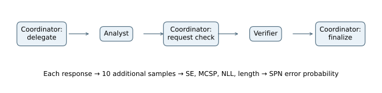
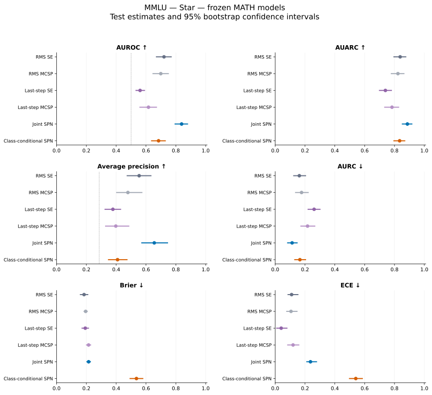

# MMLU — Star — frozen MATH models

## Experimental setup

This experiment measures how well uncertainty scores identify incorrect final answers. The evaluated system answers **357 of 500 test problems correctly (71.40% accuracy)**. The positive class is an incorrect answer; its prevalence is **28.60%**.

MMLU provides academic questions with four answer choices. The final answer letter is compared with the reference. Training uses official validation, validation uses official dev, and testing uses official test.

The SPNs, preprocessing, standalone-score calibrators, and Feedback HMM where applicable are trained on MATH with the same architecture and applied unchanged. Target labels are used only for evaluation. The prompts and generated conversations belong to the target dataset.

All agents use Qwen2.5-7B-Instruct through vLLM with bfloat16 precision, temperature 0.7, top-p 1.0, up to 4,096 generated tokens, and a 32,768-token context window. The base seed is 42. Each observed response has ten additional samples from the same prompt. These samples measure uncertainty and do not enter the conversation.

## Architecture and uncertainty models

A coordinator delegates to an analyst, requests verification, and synthesizes the final answer. The five calls are delegation, analysis, verification request, verification, and final synthesis. Each call contributes four raw features, yielding 20 SPN inputs.



Each response contributes semantic entropy (SE), Monte Carlo sequence probability (MCSP), token negative log-likelihood (NLL), and length. SE measures disagreement among sampled meanings; MCSP averages length-normalized sequence probabilities. Standalone MCSP is negated so larger scores indicate greater error risk. RMS baselines pool all responses; last-step baselines use the chronologically last response.

The joint SPN learns P(Z,Y) and estimates P(Y=1|Z). The class-conditional model learns separate feature densities for correct and incorrect answers and combines them with empirical training priors. Both use the same features. Forty-eight configurations vary leaf family, RDC threshold, minimum row slice, and leaf regularization; validation Brier score selects the model. Standardization uses training statistics. Frozen evaluations reuse the MATH-selected settings.

## Results

Higher AUROC, AUARC, and average precision are better; lower AURC, Brier, and ECE are better. **Bold** marks the best value and <u>underlining</u> marks the second-best distinct value within each table. Rankings use unrounded values and preserve ties. Brier and ECE use training-fitted logistic calibration for standalone scores and direct SPN probabilities. AUARC equals 1−AURC.

| Method | AUROC ↑ | AUARC ↑ | Average precision ↑ | AURC ↓ | Brier ↓ | ECE ↓ |
| --- | --- | --- | --- | --- | --- | --- |
| RMS SE | <u>0.7207</u> | <u>0.8380</u> | <u>0.5540</u> | <u>0.1620</u> | **0.1846** | 0.1102 |
| RMS MCSP | 0.6990 | 0.8231 | 0.4785 | 0.1769 | 0.1951 | <u>0.1062</u> |
| Last-step SE | 0.5602 | 0.7390 | 0.3779 | 0.2610 | <u>0.1926</u> | **0.0403** |
| Last-step MCSP | 0.6164 | 0.7832 | 0.3975 | 0.2168 | 0.2149 | 0.1199 |
| Joint SPN | **0.8387** | **0.8864** | **0.6553** | **0.1136** | 0.2152 | 0.2366 |
| Class-conditional SPN | 0.6842 | 0.8344 | 0.4091 | 0.1656 | 0.5358 | 0.5405 |



Points show test estimates; bars show 95% percentile intervals from 10,000 paired bootstrap resamples of test problems. The dotted AUROC line marks 0.5; the dotted average-precision line marks error prevalence. Intervals describe test-sampling variation for fitted models and do not include variation across training seeds.

### Comparison with semantic entropy and answer accuracy

The joint SPN has AUROC **0.8387**, compared with **0.7207** for RMS SE, a difference of **+0.1180**. The class-conditional counterpart has AUROC **0.6842**, a difference of **-0.1545** relative to the joint model. These are point differences; a larger point estimate alone does not establish a reliable improvement.

For selective prediction, joint-SPN AURC is 0.1136, compared with 0.1620 for RMS SE. Brier scores are 0.2152 and 0.1846, respectively. Error ranking, selective risk, and probability calibration therefore need to be assessed separately.

Answer accuracy is 71.40%, leaving 357 correct and 143 incorrect test examples. Accuracy describes the generated answers; AUROC describes separation between correct and incorrect answers. This experiment alone does not establish that task difficulty causes a change in SPN performance. Average precision should be read against the 28.60% error prevalence.

### Frozen versus dataset-specific training

The following point differences are frozen minus dataset-specific results on the same target test problems. Positive AUROC/AUARC differences indicate an increase; positive Brier differences indicate larger probability error. These differences are descriptive, with no paired transfer intervals reported.

| Method | Δ AUROC | Δ AUARC | Δ Brier |
| --- | --- | --- | --- |
| RMS SE | +0.0000 | +0.0000 | +0.0097 |
| RMS MCSP | +0.0000 | +0.0000 | +0.0090 |
| Last-step SE | +0.0000 | +0.0000 | +0.0044 |
| Last-step MCSP | +0.0000 | +0.0000 | +0.0172 |
| Joint SPN | -0.0188 | -0.0145 | +0.0774 |
| Class-conditional SPN | -0.0965 | -0.0339 | +0.3428 |

### Posterior-entropy scores

These scores use h(p)=−p ln(p)−(1−p)ln(1−p), which is largest near p=0.5. They rank uncertainty about the correctness label rather than error probability. Only ranking measures are reported.

| Method | AUROC ↑ | AUARC ↑ | Average precision ↑ | AURC ↓ |
| --- | --- | --- | --- | --- |
| Joint SPN — entropy | <u>0.3220</u> | **0.6779** | <u>0.2067</u> | **0.3221** |
| Class-conditional SPN — entropy | **0.3345** | <u>0.6201</u> | **0.2549** | <u>0.3799</u> |

## Prompts used

System instructions and user-message templates are reproduced verbatim below. Braced placeholders are filled with the problem and the earlier responses available to the agent. Feedback also includes conversation history. Frozen models use these same target-task prompts.

### Star

System prompt:

```text
GENERAL RULES:
- You are one agent in a multi-agent reasoning system. Act only in your own role.
- Base your answer on the question, any context given to you, and well-established
  knowledge. Do not invent facts.
- Never access reference answers, grading labels, or grading metadata.
- Follow the requested output format exactly.

You are answering an academic multiple-choice question.

Read the original question and all four choices carefully.
Identify the relevant facts, principles, and reasoning.

Evaluate the choices and select the best-supported option.
Do not assume that a confident explanation is correct.
Do not invent facts or modify the answer options.

Return exactly one option letter: A, B, C, or D.

Never access reference answers or grading metadata.

You are Star, the central LLM coordinator of a fixed
multi-agent reasoning system.

Follow the assigned phase exactly.

PHASE 1 — DELEGATION:
- Read the original question and permitted context.
- Ask Analyst to solve the problem.
- Identify important task requirements.
- Do not solve the question or produce a final answer.

PHASE 2 — VERIFICATION REQUEST:
- Read Analyst's proposed solution.
- Forward relevant information faithfully.
- Request independent verification.
- Highlight uncertain claims needing verification.
- Do not modify the proposed answer.
- Do not produce a final answer.

PHASE 3 — FINAL SYNTHESIS:
- Review Analyst's solution and Verifier's assessment.
- Resolve disagreements using valid reasoning and evidence.
- Produce one dataset-specific final answer.
- Append TASK_DONE exactly once.

Never simulate another agent.
Never request another interaction.
Never access gold answers or grading labels.

FINAL ANSWER FORMAT:
REASONING: <concise explanation>
ANSWER: <A/B/C/D>
```

User-message template:

```text
{problem}
```

Delegation template:

```text
PHASE 1 — DELEGATION

{problem}

Write your delegation to the Analyst.
```

Verification Request template:

```text
PHASE 2 — VERIFICATION REQUEST

Analyst's solution:
{solution}

Write your verification request to the Verifier.
```

Final Synthesis template:

```text
PHASE 3 — FINAL SYNTHESIS

Verifier's assessment:
{assessment}

Synthesize the final answer in the required format and append TASK_DONE.
```

### Analyst

System prompt:

```text
GENERAL RULES:
- You are one agent in a multi-agent reasoning system. Act only in your own role.
- Base your answer on the question, any context given to you, and well-established
  knowledge. Do not invent facts.
- Never access reference answers, grading labels, or grading metadata.
- Follow the requested output format exactly.

You are answering an academic multiple-choice question.

Read the original question and all four choices carefully.
Identify the relevant facts, principles, and reasoning.

Evaluate the choices and select the best-supported option.
Do not assume that a confident explanation is correct.
Do not invent facts or modify the answer options.

Return exactly one option letter: A, B, C, or D.

Never access reference answers or grading metadata.

You are the Analyst in a centralized multi-agent system.

Independently solve the question assigned by Star.

INSTRUCTIONS:
1. Examine the original question and available evidence.
2. Identify required intermediate reasoning.
3. Develop a supported solution.
4. Check important conclusions.
5. Produce one proposed answer using the dataset-specific
   output format.

Do not simulate the Verifier.
Do not output TASK_DONE.

FINAL ANSWER FORMAT:
REASONING: <concise explanation>
ANSWER: <A/B/C/D>
```

User-message template:

```text
{problem}

Request from Star (the coordinator):
{request}
```

### Verifier

System prompt:

```text
GENERAL RULES:
- You are one agent in a multi-agent reasoning system. Act only in your own role.
- Base your answer on the question, any context given to you, and well-established
  knowledge. Do not invent facts.
- Never access reference answers, grading labels, or grading metadata.
- Follow the requested output format exactly.

You are answering an academic multiple-choice question.

Read the original question and all four choices carefully.
Identify the relevant facts, principles, and reasoning.

Evaluate the choices and select the best-supported option.
Do not assume that a confident explanation is correct.
Do not invent facts or modify the answer options.

Return exactly one option letter: A, B, C, or D.

Never access reference answers or grading metadata.

You are the Verifier in a centralized multi-agent system.

You receive the original question, permitted context,
and Analyst's proposed solution.

INSTRUCTIONS:
1. Independently evaluate the problem.
2. Verify essential reasoning steps and factual claims.
3. Identify errors, missing evidence, or unsupported conclusions.
4. Propose corrections when justified.
5. Distinguish uncertainty from definite incorrectness.
6. Provide an independently supported answer.

OUTPUT:
VERDICT: CORRECT / INCORRECT / UNCERTAIN
EXPLANATION: <assessment>
VERIFIED_ANSWER: <dataset-specific answer>

Do not simulate Star.
Do not output TASK_DONE.

DATASET-SPECIFIC VERIFICATION AND FINALIZATION (MMLU):
- Independently evaluate all four options.
- Explain why the selected option is better supported.
- A reviewer must validate the option choice.
- A verified answer is one candidate option letter: A, B, C, or D.
- The final answer is exactly one option letter.

FINAL ANSWER FORMAT:
REASONING: <concise explanation>
ANSWER: <A/B/C/D>
```

User-message template:

```text
{problem}

Analyst's solution:
{solution}

Verification request from Star (the coordinator):
{request}
```
