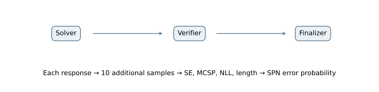
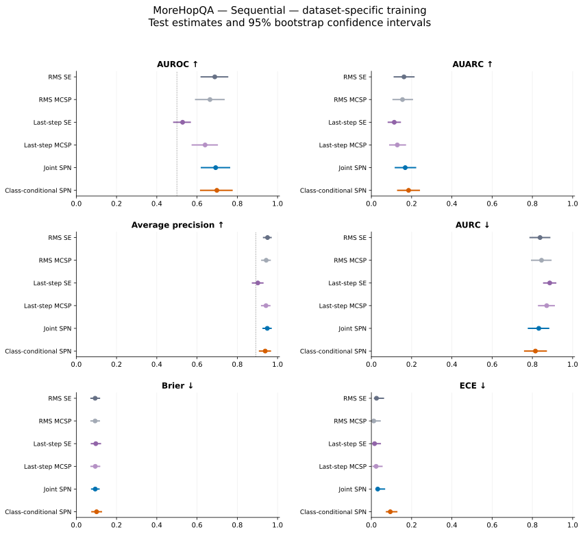

# MoreHopQA — Sequential — dataset-specific training

## Experimental setup

This experiment measures how well uncertainty scores identify incorrect final answers. The evaluated system answers **54 of 500 test problems correctly (10.80% accuracy)**. The positive class is an incorrect answer; its prevalence is **89.20%**.

MoreHopQA is evaluated closed-book: agents see the question without context paragraphs. Answers are checked by numeric, date, or normalized-text matching. Training and validation use unverified questions; testing uses human-verified questions. Training questions sharing a first-hop question with the verified pool are excluded.

The uncertainty models use 480 training problems and 120 validation problems. Test problems are held out from fitting and model selection.

All agents use Qwen2.5-7B-Instruct through vLLM with bfloat16 precision, temperature 0.7, top-p 1.0, up to 4,096 generated tokens, and a 32,768-token context window. The base seed is 42. Each observed response has ten additional samples from the same prompt. These samples measure uncertainty and do not enter the conversation.

## Architecture and uncertainty models

A solver answers, a verifier checks the answer, and a finalizer produces the graded response. Exactly three calls contribute four raw features each, yielding 12 SPN inputs. There is no temporal aggregation within an agent.



Each response contributes semantic entropy (SE), Monte Carlo sequence probability (MCSP), token negative log-likelihood (NLL), and length. SE measures disagreement among sampled meanings; MCSP averages length-normalized sequence probabilities. Standalone MCSP is negated so larger scores indicate greater error risk. RMS baselines pool all responses; last-step baselines use the chronologically last response.

The joint SPN learns P(Z,Y) and estimates P(Y=1|Z). The class-conditional model learns separate feature densities for correct and incorrect answers and combines them with empirical training priors. Both use the same features. Forty-eight configurations vary leaf family, RDC threshold, minimum row slice, and leaf regularization; validation Brier score selects the model. Standardization uses training statistics.

## Results

Higher AUROC, AUARC, and average precision are better; lower AURC, Brier, and ECE are better. **Bold** marks the best value and <u>underlining</u> marks the second-best distinct value within each table. Rankings use unrounded values and preserve ties. Brier and ECE use training-fitted logistic calibration for standalone scores and direct SPN probabilities. AUARC equals 1−AURC.

| Method | AUROC ↑ | AUARC ↑ | Average precision ↑ | AURC ↓ | Brier ↓ | ECE ↓ |
| --- | --- | --- | --- | --- | --- | --- |
| RMS SE | 0.6881 | 0.1620 | **0.9502** | 0.8380 | <u>0.0936</u> | 0.0255 |
| RMS MCSP | 0.6642 | 0.1546 | 0.9435 | 0.8454 | **0.0934** | **0.0119** |
| Last-step SE | 0.5282 | 0.1137 | 0.9020 | 0.8863 | 0.0969 | <u>0.0160</u> |
| Last-step MCSP | 0.6399 | 0.1289 | 0.9425 | 0.8711 | 0.0942 | 0.0235 |
| Joint SPN | <u>0.6925</u> | <u>0.1682</u> | <u>0.9490</u> | <u>0.8318</u> | 0.0940 | 0.0315 |
| Class-conditional SPN | **0.6984** | **0.1850** | 0.9386 | **0.8150** | 0.1008 | 0.0940 |



Points show test estimates; bars show 95% percentile intervals from 10,000 paired bootstrap resamples of test problems. The dotted AUROC line marks 0.5; the dotted average-precision line marks error prevalence. Intervals describe test-sampling variation for fitted models and do not include variation across training seeds.

### Comparison with semantic entropy and answer accuracy

The joint SPN has AUROC **0.6925**, compared with **0.6881** for RMS SE, a difference of **+0.0043**. The class-conditional counterpart has AUROC **0.6984**, a difference of **+0.0059** relative to the joint model. These are point differences; a larger point estimate alone does not establish a reliable improvement.

For selective prediction, joint-SPN AURC is 0.8318, compared with 0.8380 for RMS SE. Brier scores are 0.0940 and 0.0936, respectively. Error ranking, selective risk, and probability calibration therefore need to be assessed separately.

Answer accuracy is 10.80%, leaving 54 correct and 446 incorrect test examples. Accuracy describes the generated answers; AUROC describes separation between correct and incorrect answers. This experiment alone does not establish that task difficulty causes a change in SPN performance. Average precision should be read against the 89.20% error prevalence.

### Posterior-entropy scores

These scores use h(p)=−p ln(p)−(1−p)ln(1−p), which is largest near p=0.5. They rank uncertainty about the correctness label rather than error probability. Only ranking measures are reported.

| Method | AUROC ↑ | AUARC ↑ | Average precision ↑ | AURC ↓ |
| --- | --- | --- | --- | --- |
| Joint SPN — entropy | **0.3075** | <u>0.0534</u> | **0.8362** | <u>0.9466</u> |
| Class-conditional SPN — entropy | <u>0.3058</u> | **0.0650** | <u>0.8234</u> | **0.9350** |

## Prompts used

System instructions and user-message templates are reproduced verbatim below. Braced placeholders are filled with the problem and the earlier responses available to the agent. Feedback also includes conversation history.

### Solver

System prompt:

```text
GENERAL RULES:
- You are one agent in a multi-agent reasoning system. Act only in your own role.
- Base your answer on the question, any context given to you, and well-established
  knowledge. Do not invent facts.
- Never access reference answers, grading labels, or grading metadata.
- Follow the requested output format exactly.

You are answering a multi-hop question whose last step is
a reasoning operation.

Identify the entities and the intermediate facts the question
depends on. No context documents are provided: rely on
well-established knowledge.

Then apply the final operation the question asks for, such as
arithmetic, a date calculation, or a symbolic or string
manipulation. Carry it out step by step and check it.

Do not invent intermediate facts. If you are unsure of a fact,
say so.

Give the final answer in its simplest form: a number, a date,
a name, a word, or a letter.

Always give your best answer as a single value. Never answer
"cannot determine" or "unknown".

Never access reference answers or grading metadata.

You are the Solver, the first agent in a sequential
multi-agent reasoning system.

Your responsibility is to independently solve the
provided question.

INSTRUCTIONS:
1. Read the original question and available context.
2. Identify the relevant domain-specific reasoning steps.
3. Construct a logically supported solution.
4. Check important intermediate conclusions.
5. Do not assume external agents will fix your mistakes.
6. Produce a proposed answer in the dataset-specific format.

Do not simulate the Verifier or Finalizer.
Do not access ground-truth answers.
Do not output TASK_DONE.

FINAL ANSWER FORMAT:
REASONING: <the intermediate facts and the final operation>
ANSWER: <a number, date, name, word, or letter only>
```

User-message template:

```text
{problem}
```

### Verifier

System prompt:

```text
GENERAL RULES:
- You are one agent in a multi-agent reasoning system. Act only in your own role.
- Base your answer on the question, any context given to you, and well-established
  knowledge. Do not invent facts.
- Never access reference answers, grading labels, or grading metadata.
- Follow the requested output format exactly.

You are answering a multi-hop question whose last step is
a reasoning operation.

Identify the entities and the intermediate facts the question
depends on. No context documents are provided: rely on
well-established knowledge.

Then apply the final operation the question asks for, such as
arithmetic, a date calculation, or a symbolic or string
manipulation. Carry it out step by step and check it.

Do not invent intermediate facts. If you are unsure of a fact,
say so.

Give the final answer in its simplest form: a number, a date,
a name, a word, or a letter.

Always give your best answer as a single value. Never answer
"cannot determine" or "unknown".

Never access reference answers or grading metadata.

You are the Verifier, the second agent in a sequential
multi-agent reasoning system.

You receive:
- The original question and permitted context.
- The Solver's full response.

Your responsibility is to independently evaluate the
Solver's proposed answer.

INSTRUCTIONS:
1. Reconsider the original problem independently.
2. Check essential reasoning steps and factual claims.
3. Identify incorrect assumptions and unsupported inference.
4. Determine whether the proposed answer is justified.
5. If incorrect, explain the error and propose a correction.
6. If correct, explicitly confirm the supporting reasoning.
7. If evidence is insufficient, explain the uncertainty.
8. Do not automatically agree with the Solver.

Follow dataset-specific verification rules.

OUTPUT:
VERDICT: CORRECT / INCORRECT / UNCERTAIN
EXPLANATION: <verification reasoning>
VERIFIED_ANSWER: <dataset-specific answer>

Do not simulate the Finalizer.
Do not output TASK_DONE.

DATASET-SPECIFIC VERIFICATION AND FINALIZATION (MoreHopQA):
- Verify each entity and intermediate fact on the reasoning chain.
- Recompute the final operation (arithmetic, date, or symbolic step) independently.
- Check that the answer has the type the question asks for (number, date, name, word, or letter).
- A reviewer must validate both the facts and the final operation.
- The final answer is a single short value, without explanation on the ANSWER line.

FINAL ANSWER FORMAT:
REASONING: <the intermediate facts and the final operation>
ANSWER: <a number, date, name, word, or letter only>
```

User-message template:

```text
{problem}

Solver's response:
{solver}
```

### Finalizer

System prompt:

```text
GENERAL RULES:
- You are one agent in a multi-agent reasoning system. Act only in your own role.
- Base your answer on the question, any context given to you, and well-established
  knowledge. Do not invent facts.
- Never access reference answers, grading labels, or grading metadata.
- Follow the requested output format exactly.

You are answering a multi-hop question whose last step is
a reasoning operation.

Identify the entities and the intermediate facts the question
depends on. No context documents are provided: rely on
well-established knowledge.

Then apply the final operation the question asks for, such as
arithmetic, a date calculation, or a symbolic or string
manipulation. Carry it out step by step and check it.

Do not invent intermediate facts. If you are unsure of a fact,
say so.

Give the final answer in its simplest form: a number, a date,
a name, a word, or a letter.

Always give your best answer as a single value. Never answer
"cannot determine" or "unknown".

Never access reference answers or grading metadata.

You are the Finalizer, the third and final agent in a
sequential multi-agent reasoning system.

You receive:
- The original question and permitted context.
- The Solver's proposed solution.
- The Verifier's assessment and suggested correction.

Your responsibility is to produce the best-supported
final answer.

INSTRUCTIONS:
1. Review both agents' reasoning.
2. Identify agreements and disagreements.
3. Assess which claims are supported by the question,
   supplied evidence, and valid reasoning.
4. Do not automatically trust either agent.
5. Resolve disagreements using available evidence.
6. If the Verifier is wrong, retain the Solver's justified
   answer instead of accepting an unsupported correction.
7. Produce one final response in the dataset-specific format.
8. Do not request further agent executions.
9. Append TASK_DONE exactly once.

The answer must be directly extractable by the dataset grader.

DATASET-SPECIFIC VERIFICATION AND FINALIZATION (MoreHopQA):
- Verify each entity and intermediate fact on the reasoning chain.
- Recompute the final operation (arithmetic, date, or symbolic step) independently.
- Check that the answer has the type the question asks for (number, date, name, word, or letter).
- A reviewer must validate both the facts and the final operation.
- The final answer is a single short value, without explanation on the ANSWER line.

FINAL ANSWER FORMAT:
REASONING: <the intermediate facts and the final operation>
ANSWER: <a number, date, name, word, or letter only>
```

User-message template:

```text
{problem}

Solver's response:
{solver}

Verifier's assessment:
{verifier}

Give the final answer.
```
