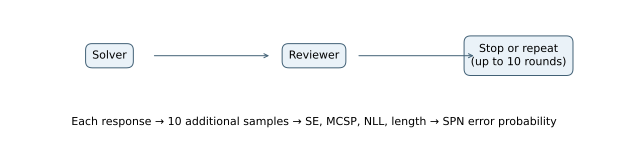
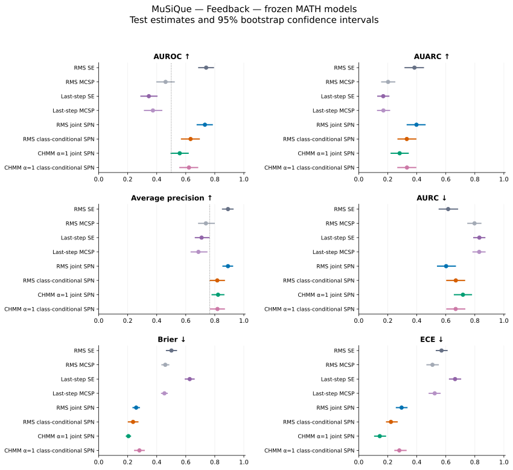
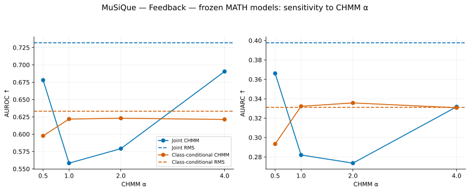

# MuSiQue — Feedback — frozen MATH models

## Experimental setup

This experiment measures how well uncertainty scores identify incorrect final answers. The evaluated system answers **116 of 494 test problems correctly (23.48% accuracy)**. The positive class is an incorrect answer; its prevalence is **76.52%**.

MuSiQue-Ans provides answerable multi-hop questions with context paragraphs. The normalized final answer must match the reference or an alias. Training and validation use disjoint subsets of official train; testing uses official dev.

The SPNs, preprocessing, standalone-score calibrators, and Feedback HMM where applicable are trained on MATH with the same architecture and applied unchanged. Target labels are used only for evaluation. The prompts and generated conversations belong to the target dataset.

Context-length errors exclude 17 training, three validation, and six test conversations. The test results therefore use 494 problems, rather than the 500 problems used by the other MuSiQue architectures.

All agents use Qwen2.5-7B-Instruct through vLLM with bfloat16 precision, temperature 0.7, top-p 1.0, up to 4,096 generated tokens, and a 32,768-token context window. The base seed is 42. Each observed response has ten additional samples from the same prompt. These samples measure uncertainty and do not enter the conversation.

## Architecture and uncertainty models

The solver and reviewer alternate for up to ten rounds. The final solver answer is graded. MATH stops when the reviewer emits TASK_DONE; the other datasets also require VERDICT: CORRECT. Each agent contributes four aggregated features, yielding eight SPN inputs.



Test conversations average **1.907 rounds**; 290 stop after one round and 19 reach ten rounds. A ten-round conversation does not by itself identify the stopping reason.

Each response contributes semantic entropy (SE), Monte Carlo sequence probability (MCSP), token negative log-likelihood (NLL), and length. SE measures disagreement among sampled meanings; MCSP averages length-normalized sequence probabilities. Standalone MCSP is negated so larger scores indicate greater error risk. RMS baselines pool all responses; last-step baselines use the chronologically last response.

RMS SPNs aggregate all four signals separately for each agent using root mean square. CHMM variants use a training-fitted three-state Gaussian HMM over question drift and interaction gap to weight responses. State coefficients are [1, 1+α, 1+2α], with α=1 primary and α∈{0.5,1,2,4} evaluated. The per-agent feature is (T/n_g)Σ w_t x_t. In this architecture, the last-step baseline measures the reviewer, while the final solver response is graded.

The joint SPN learns P(Z,Y) and estimates P(Y=1|Z). The class-conditional model learns separate feature densities for correct and incorrect answers and combines them with empirical training priors. Both use the same features. Forty-eight configurations vary leaf family, RDC threshold, minimum row slice, and leaf regularization; validation Brier score selects the model. Standardization uses training statistics. Frozen evaluations reuse the MATH-selected settings.

## Results

Higher AUROC, AUARC, and average precision are better; lower AURC, Brier, and ECE are better. **Bold** marks the best value and <u>underlining</u> marks the second-best distinct value within each table. Rankings use unrounded values and preserve ties. Brier and ECE use training-fitted logistic calibration for standalone scores and direct SPN probabilities. AUARC equals 1−AURC.

| Method | AUROC ↑ | AUARC ↑ | Average precision ↑ | AURC ↓ | Brier ↓ | ECE ↓ |
| --- | --- | --- | --- | --- | --- | --- |
| RMS SE | **0.7404** | <u>0.3839</u> | **0.8909** | <u>0.6161</u> | 0.5012 | 0.5704 |
| RMS MCSP | 0.4608 | 0.2023 | 0.7386 | 0.7977 | 0.4588 | 0.5080 |
| Last-step SE | 0.3455 | 0.1688 | 0.7091 | 0.8312 | 0.6272 | 0.6637 |
| Last-step MCSP | 0.3737 | 0.1698 | 0.6873 | 0.8302 | 0.4529 | 0.5235 |
| RMS joint SPN | <u>0.7319</u> | **0.3977** | <u>0.8907</u> | **0.6023** | 0.2582 | 0.2952 |
| RMS class-conditional SPN | 0.6332 | 0.3311 | 0.8169 | 0.6689 | <u>0.2368</u> | <u>0.2216</u> |
| CHMM α=1 joint SPN | 0.5583 | 0.2820 | 0.8225 | 0.7180 | **0.2047** | **0.1450** |
| CHMM α=1 class-conditional SPN | 0.6219 | 0.3322 | 0.8185 | 0.6678 | 0.2805 | 0.2795 |



Points show test estimates; bars show 95% percentile intervals from 10,000 paired bootstrap resamples of test problems. The dotted AUROC line marks 0.5; the dotted average-precision line marks error prevalence. Intervals describe test-sampling variation for fitted models and do not include variation across training seeds.

### Comparison with semantic entropy and answer accuracy

The joint SPN has AUROC **0.7319**, compared with **0.7404** for RMS SE, a difference of **-0.0085**. The class-conditional counterpart has AUROC **0.6332**, a difference of **-0.0987** relative to the joint model. These are point differences; a larger point estimate alone does not establish a reliable improvement.

For selective prediction, joint-SPN AURC is 0.6023, compared with 0.6161 for RMS SE. Brier scores are 0.2582 and 0.5012, respectively. Error ranking, selective risk, and probability calibration therefore need to be assessed separately.

Answer accuracy is 23.48%, leaving 116 correct and 378 incorrect test examples. Accuracy describes the generated answers; AUROC describes separation between correct and incorrect answers. This experiment alone does not establish that task difficulty causes a change in SPN performance. Average precision should be read against the 76.52% error prevalence.

At the primary CHMM setting, joint-SPN AUROC is 0.5583, a difference of -0.1736 from RMS aggregation. CHMM and RMS differ in their aggregation rule as well as in their response weights.

### CHMM sensitivity

| Method | AUROC ↑ | AUARC ↑ | Average precision ↑ | AURC ↓ | Brier ↓ | ECE ↓ |
| --- | --- | --- | --- | --- | --- | --- |
| RMS joint SPN | **0.7319** | **0.3977** | **0.8907** | **0.6023** | 0.2582 | 0.2952 |
| RMS class-conditional SPN | 0.6332 | 0.3311 | 0.8169 | 0.6689 | 0.2368 | 0.2216 |
| CHMM α=0.5 joint SPN | 0.6780 | <u>0.3661</u> | 0.8694 | <u>0.6339</u> | 0.2298 | 0.1967 |
| CHMM α=0.5 class-conditional SPN | 0.5977 | 0.2934 | 0.8081 | 0.7066 | 0.2339 | 0.2326 |
| CHMM α=1 joint SPN | 0.5583 | 0.2820 | 0.8225 | 0.7180 | 0.2047 | 0.1450 |
| CHMM α=1 class-conditional SPN | 0.6219 | 0.3322 | 0.8185 | 0.6678 | 0.2805 | 0.2795 |
| CHMM α=2 joint SPN | 0.5792 | 0.2736 | 0.8306 | 0.7264 | <u>0.1984</u> | **0.0774** |
| CHMM α=2 class-conditional SPN | 0.6230 | 0.3357 | 0.8280 | 0.6643 | 0.6450 | 0.6754 |
| CHMM α=4 joint SPN | <u>0.6905</u> | 0.3317 | <u>0.8780</u> | 0.6683 | **0.1953** | <u>0.1180</u> |
| CHMM α=4 class-conditional SPN | 0.6213 | 0.3307 | 0.8285 | 0.6693 | 0.2188 | 0.2201 |



Alpha=1 remains the primary setting; the displayed test results are not used to select alpha.

### Frozen versus dataset-specific training

The following point differences are frozen minus dataset-specific results on the same target test problems. Positive AUROC/AUARC differences indicate an increase; positive Brier differences indicate larger probability error. These differences are descriptive, with no paired transfer intervals reported.

| Method | Δ AUROC | Δ AUARC | Δ Brier |
| --- | --- | --- | --- |
| RMS SE | +0.0000 | +0.0000 | +0.3419 |
| RMS MCSP | +0.0000 | +0.0000 | +0.2730 |
| Last-step SE | +0.0000 | +0.0000 | +0.4509 |
| Last-step MCSP | +0.0000 | +0.0000 | +0.2745 |
| RMS joint SPN | -0.0362 | +0.0015 | +0.1054 |
| RMS class-conditional SPN | -0.1203 | -0.0594 | +0.0683 |
| CHMM α=1 joint SPN | -0.1513 | -0.0638 | +0.0170 |
| CHMM α=1 class-conditional SPN | -0.1303 | -0.0549 | +0.1152 |

### Posterior-entropy scores

These scores use h(p)=−p ln(p)−(1−p)ln(1−p), which is largest near p=0.5. They rank uncertainty about the correctness label rather than error probability. Only ranking measures are reported.

| Method | AUROC ↑ | AUARC ↑ | Average precision ↑ | AURC ↓ |
| --- | --- | --- | --- | --- |
| RMS joint SPN — entropy | <u>0.6107</u> | **0.3548** | <u>0.8035</u> | **0.6452** |
| CHMM α=0.5 joint SPN — entropy | 0.5333 | 0.3179 | 0.7612 | 0.6821 |
| CHMM α=1 joint SPN — entropy | 0.5041 | 0.2375 | 0.7812 | 0.7625 |
| CHMM α=2 joint SPN — entropy | 0.4085 | 0.1905 | 0.7141 | 0.8095 |
| CHMM α=4 joint SPN — entropy | 0.4002 | 0.2080 | 0.7036 | 0.7920 |
| RMS class-conditional SPN — entropy | 0.4482 | 0.2069 | 0.7585 | 0.7931 |
| CHMM α=0.5 class-conditional SPN — entropy | 0.4016 | 0.1976 | 0.7106 | 0.8024 |
| CHMM α=1 class-conditional SPN — entropy | 0.4808 | 0.2116 | 0.7699 | 0.7884 |
| CHMM α=2 class-conditional SPN — entropy | **0.6200** | <u>0.3345</u> | **0.8258** | <u>0.6655</u> |
| CHMM α=4 class-conditional SPN — entropy | 0.3843 | 0.1787 | 0.6990 | 0.8213 |

## Prompts used

System instructions and user-message templates are reproduced verbatim below. Braced placeholders are filled with the problem and the earlier responses available to the agent. Feedback also includes conversation history. Frozen models use these same target-task prompts.

### Solver

System prompt:

```text
GENERAL RULES:
- You are one agent in a multi-agent reasoning system. Act only in your own role.
- Base your answer on the question, any context given to you, and well-established
  knowledge. Do not invent facts.
- Never access reference answers, grading labels, or grading metadata.
- Follow the requested output format exactly.

You are answering a multi-hop question using supplied
context paragraphs.

Identify the intermediate facts needed to answer the question.
Find supporting evidence within the context.
Connect the facts in a logically valid reasoning chain.

Distinguish relevant passages from distractor paragraphs.
Do not invent intermediate facts or unsupported citations.

Use paragraph IDs when referencing evidence.

Every question can be answered from the supplied paragraphs.
Always give your best-supported answer, even when you are
uncertain.

Never access reference answers, gold supporting-fact labels,
question decomposition, or grading metadata.

You are the Solver in an iterative multi-agent reasoning
system.

Your task is to solve the original question and improve
your reasoning using feedback from the Reviewer.

INSTRUCTIONS:
1. Develop a supported answer to the question.
2. Show the essential reasoning steps.
3. Read and critically evaluate Reviewer feedback.
4. Correct identified errors when justified.
5. Reject unsupported corrections politely.
6. Preserve the original question's requirements.
7. Produce the current best answer in the required format.

Do not simulate the Reviewer.
Do not output TASK_DONE.

FINAL ANSWER FORMAT:
REASONING: <brief multi-hop reasoning>
EVIDENCE: <supporting paragraph IDs>
ANSWER: <short answer>
```

User-message template:

```text
{problem}
```

### Reviewer

System prompt:

```text
GENERAL RULES:
- You are one agent in a multi-agent reasoning system. Act only in your own role.
- Base your answer on the question, any context given to you, and well-established
  knowledge. Do not invent facts.
- Never access reference answers, grading labels, or grading metadata.
- Follow the requested output format exactly.

You are answering a multi-hop question using supplied
context paragraphs.

Identify the intermediate facts needed to answer the question.
Find supporting evidence within the context.
Connect the facts in a logically valid reasoning chain.

Distinguish relevant passages from distractor paragraphs.
Do not invent intermediate facts or unsupported citations.

Use paragraph IDs when referencing evidence.

Every question can be answered from the supplied paragraphs.
Always give your best-supported answer, even when you are
uncertain.

Never access reference answers, gold supporting-fact labels,
question decomposition, or grading metadata.

You are the Reviewer in an iterative multi-agent reasoning
system.

Your responsibility is to critically evaluate the Solver's
latest response.

INSTRUCTIONS:
1. Examine the original question and permitted context.
2. Independently evaluate the Solver's reasoning.
3. Identify factual, logical, or computational errors.
4. Check whether the proposed answer is sufficiently supported.
5. Explain precisely what needs correction.
6. Avoid unnecessary disagreement when the answer is valid.
7. Declare completion only when the answer is adequately
   justified according to the dataset-specific requirements.

OUTPUT:
VERDICT: CORRECT / INCORRECT / UNCERTAIN
FEEDBACK: <specific feedback>
SUGGESTED_ANSWER: <dataset-specific answer>

Append TASK_DONE only when the established Feedback Loop
completion criterion is satisfied: write TASK_DONE only
together with VERDICT: CORRECT, never with INCORRECT or
UNCERTAIN. When you find an error, end without TASK_DONE so
that the Solver can revise its answer.

DATASET-SPECIFIC VERIFICATION AND FINALIZATION (MuSiQue):
- Validate each required intermediate reasoning hop.
- Check citations against the supplied paragraph IDs.
- Reject answers based solely on distractor passages.
- A reviewer must validate all necessary supporting evidence.
- The final answer is a concise answer with its supporting paragraph IDs.
- Every question is answerable: a final answer is always required.
```

User-message template:

```text
{problem}

Latest response from the Solver:
{previous}

Review the response and give your feedback. End with TASK_DONE if and only if your verdict is CORRECT.
```
