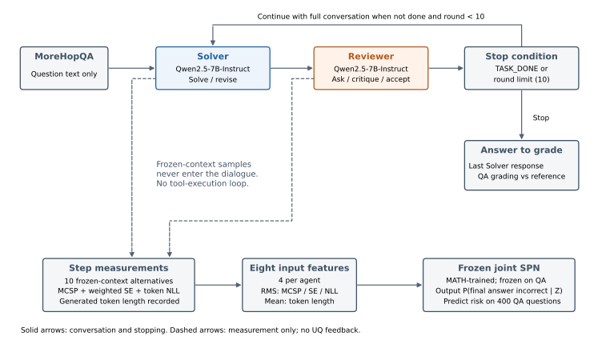
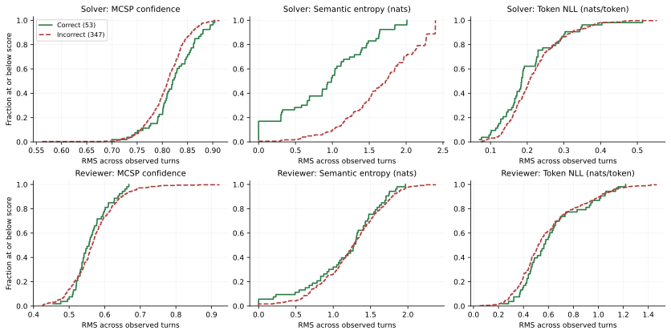
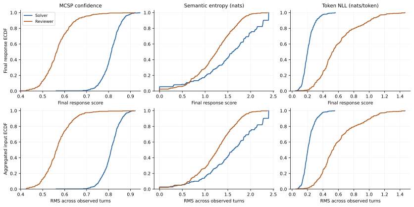
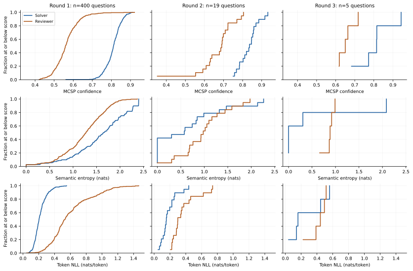
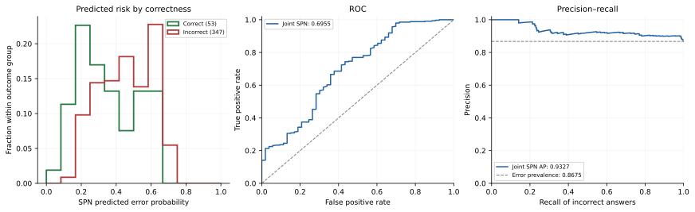
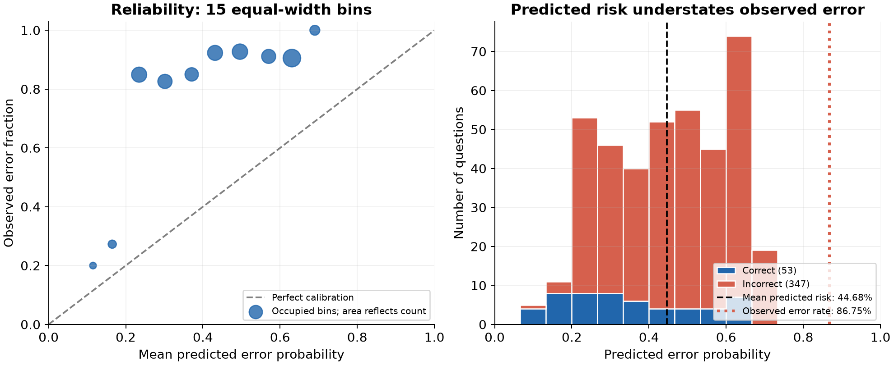
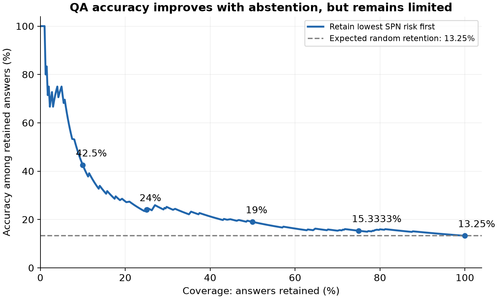

# SPUMA: Qwen2.5-7B Multi-hop QA OOD Experiment

## Introduction

This experiment asks whether a joint sum-product network (SPN), trained to estimate final-answer error risk on MATH, remains useful on closed-book multi-hop question answering. A Solver proposes and revises an answer; a Reviewer checks intermediate facts, asks questions, and decides when the discussion is complete. Both roles use Qwen/Qwen2.5-7B-Instruct. The SPN estimates error risk from their conversation and remains frozen throughout the QA evaluation.

On 400 held-out MoreHopQA questions, final-answer accuracy is **13.25% (53 correct, 347 incorrect)**. The joint SPN achieves **AUROC 0.6955** and average precision, reported as AUPRC, **0.9327**. It retains some ability to rank errors, but substantially underestimates their frequency: mean predicted error risk is **44.68%**, while the observed error rate is **86.75%**.

The report covers the joint SPN and its QA evaluation. Numeric summaries and figures use the saved predictions and response measurements. No language-model generation, SPN retraining, recalibration, hyperparameter search, or new bootstrap run is performed.

## Dataset, usable samples, and target

The dataset is the human-verified MoreHopQA test set, loaded from `alabnii/morehopqa` at revision `e839079eb8eb686ecf42c6d334a87964f1b90eef`, using `verified/test-00000-of-00001.parquet`. The evaluation samples 400 questions with seed 42. Agents receive only the question, with no supporting passages, retrieval, or search tools. The result therefore reflects closed-book knowledge and reasoning.

| Partition | Requested | Usable | Incorrect | Accuracy |
| --- | ---: | ---: | ---: | ---: |
| QA test | 400 | 400 | 347 | 13.25% |

No QA examples are used to train or tune the SPN, and no test questions are skipped. Each question yields one feature vector and one final-answer correctness label.

$$
Y_i=\begin{cases}0,&\text{final Solver answer correct},\\1,&\text{final Solver answer incorrect}.\end{cases}
$$

The final Solver response is graded, rather than the Reviewer's response. The grader extracts its last boxed answer and compares it with the reference. Text matching normalizes case, punctuation, articles, and whitespace; numeric and date answers also support typed equivalence checks. Missing extractable boxed answers count as incorrect.

There are **36 parsing failures (9.0%)**, all retained in the main analysis, and **311 extracted answers that fail grading**. Among the 364 questions with an extractable answer, accuracy is still only **14.56% (53/364)**. Formatting failures explain a small part of the low accuracy. The grader assesses final answers, not every intermediate factual claim; acceptable aliases outside its matching rules can still be marked incorrect.

## Multi-agent feedback workflow

Each round contains two responses. The Solver receives the original question and conversation history, breaks the task into intermediate facts, and gives a short boxed answer. The Reviewer checks the answer and reasoning, asks for clarification, and provides feedback without answering independently. Each role sees its own earlier responses as assistant messages and the other role's responses as user inputs.

The system prompts below are copied from the saved QA configuration, with line wrapping added for readability.

Solver system prompt:

```text
You are the Solver, an expert in multi-hop question answering. Answer questions
accurately from your own knowledge by breaking them into intermediate facts and
reasoning steps, explain your reasoning clearly, and respond to the Reviewer's questions
and feedback. Correct mistakes when necessary, maintain conversation context, and
present the final answer, as short as possible (a name, date, number or phrase), using
\boxed{}.
```

Reviewer system prompt:

```text
You are the Reviewer, collaborating with the Solver. Carefully examine the Solver's
answers, check each intermediate fact and reasoning step, ask relevant questions,
request clarifications, and provide constructive feedback. Do not answer the question
yourself. When the answer is sufficiently complete and convincing, end your response
with TASK_DONE. Otherwise, continue the discussion naturally.
```

The workflow stops when the Reviewer response contains `TASK_DONE`, or after ten rounds. Uncertainty is measured after each response but does not enter the conversation or determine stopping. The ten Monte Carlo alternatives are generated from the frozen context of a response and never become extra dialogue turns. References are used only by the grader; the SPN's predicted risk is evaluated separately.



Figure 1. Feedback workflow and measurement path. Solid arrows carry the conversation and stopping decision; dashed arrows carry recorded responses to uncertainty measurement. Continued dialogue returns to the Solver. The final Solver answer is graded separately, while the lower path aggregates eight features and queries the frozen SPN. No QA fitting or recalibration takes place.

All 400 conversations terminate with `TASK_DONE`, including all 347 incorrect answers. **381 questions (95.25%) finish after one round**, 14 after two rounds, and five after three. Mean length is **1.06 rounds**, giving **848 observed agent responses**. Completion indicates the Reviewer's stopping decision, rather than verified correctness. The longer conversations are too few and too selected to establish a benefit from additional feedback.

| Setting | Saved value |
| --- | --- |
| Language model | Qwen/Qwen2.5-7B-Instruct |
| Generation and token scoring | vLLM; scoring backend same |
| Precision / tensor parallelism | bfloat16 / one shard |
| Sampling | Temperature 0.7; top-p 1.0; no top-k truncation |
| Maximum continuation / context | 2,048 / 8,192 tokens |
| Concurrent problems | 8 |
| Monte Carlo alternatives | 10 per response, from its frozen context |
| NLI fallback | tasksource/ModernBERT-large-nli; batch size 32 |
| NLI limits | 8,000 characters per text; 2,048 tokens per pair |
| Seed / generator revisions | 42 / model and tokenizer revisions unpinned |

## Step-level confidence and uncertainty measures

This run records Monte Carlo sequence probability (MCSP), likelihood-weighted semantic entropy (SE), token negative log-likelihood (NLL), and generated token length. It does not record full-vocabulary predictive entropy (PE). MCSP is a confidence score: larger means more probable responses. SE and NLL are uncertainty scores: larger means more disagreement or less probable realized tokens. All logarithms are natural and token scores use the raw model distribution.

For context c and response y of length L, the implementation defines a length-normalized sequence score q(y) by the geometric mean of token probabilities. This score lies between zero and one, but is not a normalized probability distribution over all possible response strings.

$$
\begin{equation}
\begin{aligned}
q_\theta(y \mid c)
&= \exp\left(
\frac{1}{L} \sum_{t=1}^{L}
\log p_\theta(y_t \mid c, y_{<t})
\right), \\
\mathrm{NLL}_\theta(y \mid c)
&= -\frac{1}{L} \sum_{t=1}^{L}
\log p_\theta(y_t \mid c, y_{<t}).
\end{aligned}
\end{equation}
$$

MCSP averages q over the actual response and its ten independently seeded alternatives. It summarizes sampled response confidence, rather than entropy over the next-token vocabulary.

$$
\mathrm{MCSP}=\frac{1}{11}\sum_{j=0}^{10}q(y^{(j)}\mid c).
$$

SE clusters these eleven responses by meaning. For two boxed answers, the QA comparison uses normalized text equality or date equivalence for text-like answers, and Math-Verify for other answers. Exactly one boxed answer means different responses; neither boxed answer triggers NLI entailment in either direction. The reference answer is never involved. UQLM's tokenprob entropy weights clusters by response scores rather than by unweighted counts.

$$
w_k=\sum_{j\in C_k}q(y^{(j)}\mid c),\qquad \pi_k=\frac{w_k}{\sum_\ell w_\ell},\qquad \mathrm{SE}=-\sum_k\pi_k\log\pi_k.
$$

UQLM compares responses with existing cluster representatives, and approximate comparisons may permit overlapping memberships; the denominator sums the resulting cluster weights. This is a sample-based estimate, not exact entropy over all possible answers. Eleven responses give at most eleven clusters and an upper bound ln(11), approximately 2.398 nats. Zero SE means observed semantic agreement, which may still be agreement on an incorrect answer.

The completion marker is removed from scored text and rescored on the generating backend when other text remains. A marker-only response retains its generated tokens. Token length corresponds to this scoring view. This avoids treating the routine TASK_DONE string as substantive content when a nonempty response remains, but marker-only decisions can still affect the signals.

## Exactly what enters the SPN

Each problem produces one eight-dimensional vector Z: four aggregates from each agent. MCSP, SE, and token NLL use root mean square (RMS) across that agent's observed responses; token length uses an arithmetic mean. RMS gives high-valued episodes more influence than a mean. For MCSP this emphasizes high-confidence episodes, not high-uncertainty episodes.

$$
U_{ia}^{(m)}=\sqrt{\frac{1}{T_{ia}}\sum_{s=1}^{T_{ia}}(u_{ias}^{(m)})^2},\qquad \overline L_{ia}=\frac{1}{T_{ia}}\sum_{s=1}^{T_{ia}}L_{ias}.
$$

| Input | Agent | Measurement | Aggregation |
| --- | --- | --- | --- |
| F1 | Solver | MCSP confidence | RMS |
| F2 | Solver | Semantic entropy | RMS |
| F3 | Solver | Token NLL | RMS |
| F4 | Solver | Token length | Mean |
| F5 | Reviewer | MCSP confidence | RMS |
| F6 | Reviewer | Semantic entropy | RMS |
| F7 | Reviewer | Token NLL | RMS |
| F8 | Reviewer | Token length | Mean |

```text
Feature order in the saved checkpoint:
F1: mathematician_mcsp
F2: mathematician_se
F3: mathematician_nll
F4: mathematician_length
F5: enthusiast_mcsp
F6: enthusiast_se
F7: enthusiast_nll
F8: enthusiast_length
```

Raw problem text, reference solutions, final-answer correctness, problem identifiers, split labels, round count, and termination reason are not SPN prediction inputs. Y was an additional observed variable during source training only; QA labels are used only for grading and evaluation. The joint training table therefore has nine columns: eight features plus Y. At prediction time, the true label is unknown and the model evaluates both hypothetical label values to calculate error probability.

$$
U_{\mathrm{SPUMA}}(Z)=P(Y=1\mid Z)=\frac{P(Z,Y=1)}{P(Z,Y=0)+P(Z,Y=1)}.
$$

This final score expresses the model's estimated risk that the completed answer is wrong. It differs from response-level SE, and from posterior entropy H(Y|Z), which peaks at error probability 0.5. A confidently incorrect answer should have high error risk but can have low posterior entropy.

## Trained joint SPN and why leaves outnumber inputs

The frozen checkpoint is the same network used in the MATH experiment; its SHA-256 matches the saved QA evaluation. LearnSPN learns weighted sums representing mixtures and products representing factorized variable groups. The source-trained checkpoint has 46 sum modules, 72 product modules, 75 histogram leaf modules, and 25 binary label leaf modules: 218 statistical modules and 217 edges. Tensor-concatenation and module-list wrappers are implementation details and are not counted as statistical nodes.

The eight inputs identify variables, while leaves identify local distributions within learned mixture branches. The same variable can have different distributions in many branches, so it appears in several leaf modules. A histogram leaf module can also model multiple variables independently. Thus leaf count is neither the number of inputs nor necessarily the number of scalar distributions. A binary label leaf module internally represents a weighted pair of Y=0/Y=1 indicators; those two conceptual indicators are not counted as two separate exported modules.

For example, a two-component mixture of histograms for one variable has one input but two histogram leaves, one distribution for each component. Learned SPN mixtures repeat this pattern across features and branches. In this checkpoint, the 75 histogram modules contain 101 scalar-variable scope occurrences; the 25 label modules add 25 occurrences of Y. None of these repeated local distributions introduces a new input variable.

| Variable | Leaf-module scope occurrences |
| --- | --- |
| F1: mathematician_mcsp | 23 |
| F2: mathematician_se | 25 |
| F3: mathematician_nll | 23 |
| F4: mathematician_length | 13 |
| F5: enthusiast_mcsp | 7 |
| F6: enthusiast_se | 1 |
| F7: enthusiast_nll | 7 |
| F8: enthusiast_length | 2 |
| Y: incorrect label | 25 |

These occurrence counts describe topology, not feature importance. Repeated leaves do not create additional observations, additional input columns, or train/test duplication. The 100 leaf modules are the sum of 75 histogram modules and 25 label modules; histogram bins and tails are parameters inside a leaf, not extra leaves.


Figure 2. Frozen checkpoint root factorization, with deeper subtrees collapsed for readability. F1-F8 correspond to the input table. The root product has a label-dependent sum block over F1,F2,F3,F4,F8,Y; a separate sum block over F5,F7; and a histogram factor over F6. The first block has two weighted subtrees with weights read from the checkpoint. The overview collapses deeper branches and does not depict all 218 modules.

A consequential structural result is that the Reviewer's MCSP and NLL (F5,F7) form a factor separate from Y, and Reviewer SE (F6) forms another separate factor. Both factors cancel in the posterior ratio P(Y=1|Z). In this fitted network, error-risk predictions therefore depend on the four Solver inputs plus Reviewer mean length (F8), even though all eight features were offered to learning. This is a fitted independence assumption, not proof that the excluded signals cannot improve another model or another SPN structure.

| SPN setting | Value |
| --- | --- |
| Structure learner | SPFlow LearnSPN; two-way clustering |
| Minimum rows / feature slice | 50 / 2 |
| RDC dependence threshold | 0.3 |
| Continuous leaf | 10 uniform training-derived bins plus two exponential tails |
| Histogram / label smoothing | 1.0 / 1.0 |
| Standardization | Training means and standard deviations only |
| Label dependence rule | Avoid isolating a varying Y in its own independent product block |

All structure, histogram bins and tails, mixture weights, priors, and standardization parameters remain fixed during QA evaluation. No QA training or validation split is used to update them.

## Observed uncertainty distributions

The Solver has mean RMS semantic entropy **1.572 nats**, with exactly zero SE on **2.8%** of questions. The Reviewer has mean RMS SE **1.231 nats**, with exact zeros on **2.2%**. Mean RMS MCSP is **0.810 versus 0.568**, and mean RMS token NLL is **0.217 versus 0.595**, for Solver versus Reviewer. Mean response length is **157.5 versus 96.8 tokens**. Length uses a mean across turns, while the three uncertainty and confidence measures use RMS.

| Agent | Measure | Aggregate mean | Aggregate median | Exact zero (%) |
| --- | --- | ---: | ---: | ---: |
| Solver | MCSP | 0.810 | 0.812 | 0.0 |
| Solver | SE | 1.572 | 1.625 | 2.8 |
| Solver | NLL | 0.217 | 0.203 | 0.0 |
| Solver | Length (tokens) | 157.499 | 154.500 | 0.0 |
| Reviewer | MCSP | 0.568 | 0.563 | 0.0 |
| Reviewer | SE | 1.231 | 1.274 | 2.2 |
| Reviewer | NLL | 0.595 | 0.528 | 0.0 |
| Reviewer | Length (tokens) | 96.828 | 82.500 | 0.0 |

The measures have different units and directions, so their numerical magnitudes are not directly comparable. Roles also differ: varied Reviewer feedback can have high semantic entropy without expressing disagreement over a final answer. Zero SE means that sampled responses agree under the equivalence procedure; agreement can still be wrong.



Figure 3. Distributions of the aggregated signals. Rows show Solver and Reviewer; columns show RMS MCSP, SE, and token NLL. Green solid curves represent 53 correct answers and red dashed curves represent 347 incorrect answers. Each curve is an empirical cumulative distribution function (ECDF), normalized within its outcome group. Solver SE provides the clearest separation.

| Agent | Measure | Correct mean | Incorrect mean | Raw AUROC |
| --- | --- | ---: | ---: | ---: |
| Solver | MCSP | 0.823 | 0.808 | 0.596 |
| Solver | SE | 0.909 | 1.673 | 0.829 |
| Solver | NLL | 0.204 | 0.219 | 0.575 |
| Solver | Length (tokens) | 163.877 | 156.524 | 0.427 |
| Reviewer | MCSP | 0.562 | 0.569 | 0.468 |
| Reviewer | SE | 1.162 | 1.242 | 0.530 |
| Reviewer | NLL | 0.623 | 0.591 | 0.453 |
| Reviewer | Length (tokens) | 102.972 | 95.889 | 0.451 |

Single-feature AUROC uses `1−MCSP` for confidence and the original SE, NLL, and length values. Directions follow the measurement definitions and are not flipped after inspecting the test results. Solver SE is the strongest individual ranking signal. The Reviewer measurements are close to chance, while Solver MCSP and NLL carry weaker discrimination. These comparisons do not measure each input's causal contribution to the jointly fitted network; that would require controlled ablations.



Figure 4. Final-response scores (top) versus all-turn RMS inputs (bottom). Columns show MCSP, SE, and token NLL. Blue is Solver and orange is Reviewer. All curves use the same 400 questions. The views are similar because 95.25% of questions have only one response from each agent, for which RMS equals the observed score.



Figure 5. Per-round response distributions. Rows show MCSP, SE, and token NLL; columns show rounds 1–3. The rounds contain 400, 19, and five questions respectively. Blue is Solver and orange is Reviewer. Within each metric, the horizontal range is shared across rounds. Later rounds are small, selected samples and do not establish that feedback reduces uncertainty.

An ECDF height of 0.8 means that 80% of the displayed group's scores are at or below that value. Jumps at zero show exact-zero measurements. Missing rounds are not imputed as zero. Responses from the same question are correlated, so evaluation intervals resample whole questions rather than treating all 848 responses as independent test cases.

## Discrimination: detecting incorrect final answers

The positive class is an incorrect final Solver answer. AUROC is the probability that an incorrect answer receives higher risk than a correct answer, with ties counted as one half. Chance ranking has AUROC 0.5. AUPRC is calculated as average precision, rather than trapezoidal precision–recall area.

| Measure | QA test (95% CI) |
| --- | --- |
| AUROC | 0.6955 [0.6141, 0.7716] |
| AUPRC / average precision | 0.9327 [0.9048, 0.9568] |
| AUARC | 0.2454 [0.1767, 0.3078] |
| Answer accuracy | 0.1325 [0.1000, 0.1675] |

The SPN's AUROC interval lies above 0.5, supporting useful error discrimination in this sample. Its high average precision needs the class balance for interpretation: **86.75% of answers are incorrect**, so the precision–recall prevalence reference is already **0.8675**. Average precision of 0.9327 is 0.0652 above that reference and does not indicate high answer accuracy.

| Test ranking score | AUROC | Average precision | AUARC |
| --- | ---: | ---: | ---: |
| Joint SPN error probability | 0.6955 | 0.9327 | 0.2454 |
| SPN posterior entropy | 0.6550 | 0.9164 | 0.2356 |
| Solver RMS MCSP alone (1−MCSP) | 0.5961 | 0.8922 | 0.1831 |
| Solver RMS NLL alone | 0.5753 | 0.8841 | 0.1754 |

The single-feature comparisons are exploratory; no paired significance test or fresh confirmatory evaluation was performed. Unscaled feature scores are not probabilities and are not used for calibration or Brier-score comparisons.

Intervals use **1,000 percentile bootstrap resamples of question identifiers with 95% confidence**, as stored with the evaluation. They describe uncertainty conditional on this run and sample, rather than variation across independent generation runs, checkpoints, or datasets. No acceptance threshold is tuned on the test set.



Figure 6. Error detection on 400 QA questions. Left: predicted-risk histograms normalized separately within correct and incorrect answers. Middle: ROC curves, with a chance diagonal. Right: precision versus recall for incorrect answers, with the 0.8675 error-prevalence reference. These are descriptive curves calculated from the saved predictions.

SPN posterior entropy ranks errors less well than direct error probability: AUROC **0.6550** versus **0.6955**, and average precision **0.9164** versus **0.9327**. Posterior entropy peaks near predicted error probability 0.5 and can be low for confidently predicted errors. Direct error risk is therefore the primary SPN score in this evaluation.

## Calibration and selective prediction

| QA test measure | Value and 95% bootstrap CI |
| --- | --- |
| Brier score | 0.2904 [0.2740, 0.3080] |
| ECE (15 bins) | 0.4207 [0.3888, 0.4544] |
| Binary risk NLL | 0.7847 [0.7482, 0.8232] |
| Area under risk–coverage (AURC) | 0.7546 [0.6922, 0.8233] |
| Area under accuracy–coverage (AUARC) | 0.2454 [0.1767, 0.3078] |

Brier score averages squared probability errors. ECE summarizes the absolute difference between predicted and observed error frequency in 15 equal-width bins. Binary risk NLL scores the final correctness label and differs from the response-token NLL used as an input feature. Lower values are better for these three measures.



Figure 7. Left: observed error fractions versus mean predicted error probability in occupied bins; marker area reflects bin count. Right: score counts split by correctness, with the mean predicted risk and overall observed error rate marked. Bin-level uncertainty intervals are not shown.

Mean predicted risk is **44.68%**, compared with **86.75%** observed errors. Correct answers receive mean risk **35.04%**, while incorrect answers receive **46.15%**. This separation allows some useful ranking even though the probability scale is too optimistic. At an illustrative threshold of 0.5, the model leaves 240 answers below the threshold, of which only **39 are correct (16.25% accuracy)**. This is a descriptive example, not a validated acceptance policy.

AUARC averages accuracy over the subsets retained by increasing predicted risk. Higher is better. Equal scores use the expected accuracy under a uniformly random ordering within each tied group.

$$
\operatorname{AUARC}=\frac{1}{n}\sum_{k=1}^{n}\operatorname{Accuracy}(k/n)=1-\operatorname{AURC}.
$$

| Coverage | Answers retained | Retained-set accuracy |
| --- | ---: | ---: |
| 10% | 40 | 42.50% |
| 25% | 100 | 24.00% |
| 50% | 200 | 19.00% |
| 75% | 300 | 15.33% |
| 100% | 400 | 13.25% |



Figure 8. Retaining lower-risk answers improves accuracy over random retention in expectation. At 10% coverage, accuracy reaches 42.5%, but 90% of questions receive no retained answer and 57.5% of the retained answers are still wrong. Individual coverage points have no separate confidence intervals.

The SPN's **AUARC is 0.2454** and **AURC is 0.7546**. These summarize selective accuracy and error across coverage levels, while full-coverage accuracy remains **13.25%**. Selection improves the retained subset; it does not correct any generated answer.

The frozen SPN retains error-ranking information on these QA questions, but its probabilities are not calibrated for this setting. The results are limited to one generator, one QA configuration, one sampled test set, and one frozen checkpoint. Grading errors have not all been manually audited. A reliable acceptance policy would require separate QA validation data, followed by evaluation on fresh held-out questions.
