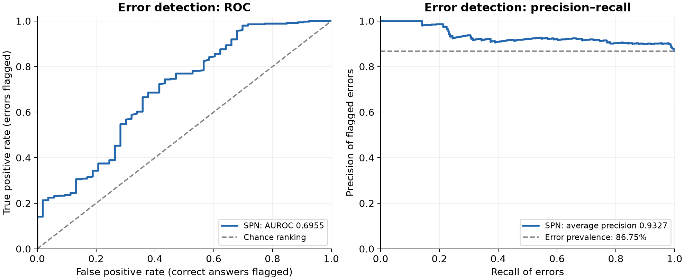

# How well does SPUMA recognize its mistakes on multi-hop QA?

This experiment tests whether SPUMA can recognize unreliable answers when moving to a new task. A sum-product network (SPN), previously trained to estimate error risk on MATH, is evaluated on 400 MoreHopQA questions. The risk model stays frozen throughout the experiment.

The main finding is that **SPUMA can partly distinguish correct answers from incorrect ones, but it is much too optimistic about how often the answers are wrong**. Answer accuracy is only **13.25%**. Selecting the answers with the lowest predicted risk improves accuracy, although even the best-ranked 10% contain more wrong answers than correct ones.

## How the experiment works

Two agents, both using **Qwen/Qwen2.5-7B-Instruct**, work through each question. The Solver is asked to break the question into intermediate facts, explain its reasoning, and give a short final answer inside `\boxed{...}`. The Reviewer checks the reasoning, asks for clarification, and provides feedback. It ends the discussion with `TASK_DONE` when it considers the answer convincing.

The agents receive only the question. They have no supporting passages, search tools, or retrieved evidence, so the experiment depends on their internal knowledge and reasoning. Up to ten rounds are allowed. Responses are sampled at temperature 0.7 and top-p 1.0, with a maximum of 2,048 new tokens per response.

The SPN estimates the probability that the final answer is wrong using four measurements from each agent: Monte Carlo sequence probability, semantic entropy, token negative log-likelihood, and response length. The first two use ten additional sampled responses to measure how consistently the model answers. Measurements are combined across conversation turns before being passed to the SPN. No QA labels are used to retrain or recalibrate it.

The evaluation uses a sample of 400 questions from the human-verified MoreHopQA test set, selected with seed 42. The grader compares the final boxed answer with the reference, allowing normalized text matches and numeric or date equivalence where applicable. A missing extractable boxed answer counts as incorrect.

## Most answers are wrong, despite reviewer approval

The system answers **53 of 400 questions correctly**. Of the 347 incorrect answers, 36 have no extractable boxed answer and 311 have an extracted answer that fails grading.

| Final outcome | Questions | Share |
|---|---:|---:|
| Correct answer | 53 | 13.25% |
| Incorrect answer with an extractable answer | 311 | 77.75% |
| Answer-parsing failure | 36 | 9.00% |
| **Total** | **400** | **100%** |

Formatting problems explain only a small part of the result. Even among the 364 questions with an extractable answer, accuracy is just **14.56%**.

Most discussions are brief: **381 questions finish after one Solver–Reviewer exchange**, 14 take two rounds, and five take three. All 400 end with the Reviewer's completion signal, including all 347 incorrect answers. Reviewer approval therefore provides little assurance that the final answer is correct in this run.

The longer discussions are too few, and arise on a selected subset of questions, to tell us whether extra feedback improves performance.

## The risk scores still help identify errors

The SPN achieves an **AUROC of 0.6955**. In practical terms, when comparing a randomly selected incorrect answer with a randomly selected correct one, it assigns the incorrect answer a higher risk about 69.55% of the time, counting ties as half. This is above chance, but leaves considerable overlap between the two groups.

*Figure 1. The SPN has useful error-ranking ability. The high precision–recall baseline reflects the fact that 86.75% of answers are already incorrect.*

Average precision, reported as AUPRC, is **0.9327**. That value needs context: errors are so common that the no-skill precision reference is already **0.8675**. The score describes detection of wrong answers, not the accuracy of generated answers.

The full results are shown below. The 95% intervals come from 1,000 bootstrap resamples of questions, using seed 42.

| Measure | Result | 95% interval |
|---|---:|---:|
| Answer accuracy | 13.25% | 10.00–16.75% |
| AUROC | 0.6955 | 0.6141–0.7716 |
| Average precision (AUPRC) | 0.9327 | 0.9048–0.9568 |
| Area under the accuracy–coverage curve (AUARC) | 0.2454 | 0.1767–0.3078 |
| Area under the risk–coverage curve (AURC) | 0.7546 | 0.6922–0.8233 |
| Brier score | 0.2904 | 0.2740–0.3080 |
| Expected calibration error (15 bins) | 0.4207 | 0.3888–0.4544 |
| Final-label negative log-likelihood | 0.7847 | 0.7482–0.8232 |

Higher values are better for the first four measures; lower values are better for the remaining four. The last three assess how closely predicted probabilities agree with actual outcomes.

## Keeping fewer answers improves accuracy, with a large trade-off

One way to use the risk scores is to withhold the answers that appear least reliable. Here, coverage means the fraction of answers retained, starting with the lowest predicted risk.

| Answers retained | Number of answers | Accuracy |
|---|---:|---:|
| Lowest-risk 10% | 40 | 42.50% |
| Lowest-risk 25% | 100 | 24.00% |
| Lowest-risk 50% | 200 | 19.00% |
| Lowest-risk 75% | 300 | 15.33% |
| All answers | 400 | 13.25% |

*Figure 2. Accuracy improves when higher-risk answers are withheld. Equal scores are handled by averaging over possible orderings within each tied group.*

At 10% coverage, accuracy rises from **13.25% to 42.5%**. That is a meaningful improvement in selection, but it requires withholding answers to 360 questions. Among the 40 retained answers, **57.5% are still wrong**.

AUARC summarizes retained-answer accuracy across all coverage levels and is **0.2454**. It should not be read as the accuracy when answering every question, which remains 13.25%. The coverage results describe this sample; they do not establish a threshold for future use.

### Why AUARC is 0.94 on MATH but 0.25 here

AUARC averages the accuracy of the retained answers over every coverage level, so it is bounded by how many correct answers exist. A random ordering scores about the overall accuracy. A perfect ordering keeps all correct answers first, giving accuracy 1 until they run out and c/k afterwards (c correct answers, k retained):

$$
\operatorname{AUARC}_{\text{oracle}}=\frac{1}{n}\Big(c+\sum_{k=c+1}^{n}\frac{c}{k}\Big).
$$

| Dataset | Accuracy | Random AUARC | SPN AUARC | Oracle AUARC | Share of random→oracle gap closed |
|---|---:|---:|---:|---:|---:|
| MATH (test, n = 500) | 75.00% | 0.7500 | 0.9413 | 0.9655 | 88.8% |
| MoreHopQA (n = 400) | 13.25% | 0.1325 | 0.2454 | 0.3992 | 42.3% |

With 53 correct answers out of 400, even a perfect risk model could not exceed **0.399**. Most of the drop from 0.94 to 0.25 therefore comes from the drop in answer accuracy, not from the ranking. The ranking also weakens: the SPN closes 42.3% of the random-to-oracle gap on MoreHopQA versus 88.8% on MATH, consistent with AUROC falling from 0.9165 to 0.6955. Raw AUARC values are not comparable across datasets with different accuracy.

## Predicted risk is far below the actual error rate

The largest problem is the probability scale. The SPN predicts an average error risk of **44.68%**, while **86.75%** of answers are actually wrong: a gap of **42.07 percentage points**.

*Figure 3. Left: observed error rates are generally well above predicted probabilities. Each point represents an occupied probability bin, with larger markers indicating more questions. Right: predicted risks remain well below the overall observed error rate.*

Correct answers receive an average predicted risk of **35.04%**, compared with **46.15%** for incorrect answers. This difference helps the SPN rank answers, but the estimates are too low to serve as trustworthy probabilities of error.

For example, consider accepting answers whose predicted error risk is below 50%. That would retain 240 answers, of which only **39 are correct: 16.25% accuracy**. A seemingly reassuring score therefore offers little protection against wrong answers in this experiment.

The calibration measures tell the same story. Expected calibration error is **0.4207**, Brier score is **0.2904**, and final-label negative log-likelihood is **0.7847**. These values assess the SPN's final error predictions; the last measure is separate from the token-level likelihood used as an input feature.

## Observed uncertainty distributions

The SPN inputs are the per-agent RMS over turns of each measure, as on MATH. The table compares MoreHopQA with the MATH test set the SPN was trained on. The agent ids remain `mathematician` and `enthusiast` because the SPN's features are named after them; on MoreHopQA they play the Solver and Reviewer.

| Agent | Measure | MATH RMS mean | MoreHopQA RMS mean | MoreHopQA RMS median | MoreHopQA exact zero (%) |
| --- | --- | ---: | ---: | ---: | ---: |
| Solver | MCSP | 0.925 | 0.810 | 0.812 | 0.0 |
| Solver | SE | 0.483 | 1.572 | 1.625 | 2.8 |
| Solver | NLL | 0.078 | 0.217 | 0.203 | 0.0 |
| Solver | Length (tokens) | 547.5 | 157.5 | 154.5 | 0.0 |
| Reviewer | MCSP | 0.636 | 0.568 | 0.563 | 0.0 |
| Reviewer | SE | 1.586 | 1.231 | 1.274 | 2.2 |
| Reviewer | NLL | 0.478 | 0.595 | 0.528 | 0.0 |
| Reviewer | Length (tokens) | 136.8 | 96.8 | 82.5 | 0.0 |

The Solver is much less certain than the Mathematician was on MATH. Its mean SE triples (0.483 → 1.572 nats), and only 2.8% of questions have zero SE, compared with 56.0% on MATH. Its MCSP drops from 0.925 to 0.810, and its token NLL almost triples. Its responses are about a third as long. The Solver's inputs therefore lie largely outside the range the SPN saw in training, which explains the calibration failure.

| Agent | Measure | Correct mean | Incorrect mean | MoreHopQA AUROC | MATH AUROC |
| --- | --- | ---: | ---: | ---: | ---: |
| Solver | MCSP | 0.823 | 0.808 | 0.596 | 0.686 |
| Solver | SE | 0.909 | 1.673 | **0.829** | 0.945 |
| Solver | NLL | 0.204 | 0.219 | 0.575 | 0.674 |
| Solver | Length | 163.9 | 156.5 | 0.427 | 0.785 |
| Reviewer | MCSP | 0.562 | 0.569 | 0.468 | 0.476 |
| Reviewer | SE | 1.162 | 1.242 | 0.530 | 0.574 |
| Reviewer | NLL | 0.623 | 0.591 | 0.453 | 0.487 |
| Reviewer | Length | 103.0 | 95.9 | 0.451 | 0.684 |

As in the MATH report, single-feature AUROC uses 1-MCSP and the original SE, NLL and length, so higher means more uncertain; values below 0.5 are kept rather than flipped. Solver SE is the only measure that transfers well. MCSP and NLL keep a weak signal. Response length reverses direction: on MATH, wrong answers were longer, while on MoreHopQA they are slightly shorter. All Reviewer measures are close to chance on both datasets, consistent with the Reviewer approving every answer.

## Comparison with simpler scores

| Ranking score | AUROC (95% CI) | Average precision (95% CI) | AUARC (95% CI) |
| --- | --- | --- | --- |
| Joint SPN error probability | 0.6955 [0.6141, 0.7716] | 0.9327 [0.9048, 0.9568] | 0.2454 [0.1767, 0.3078] |
| SPN posterior entropy | 0.6550 [0.5668, 0.7396] | 0.9164 [0.8802, 0.9466] | 0.2356 [0.1689, 0.2969] |
| Solver RMS SE alone | **0.8293** [0.7692, 0.8840] | **0.9675** [0.9518, 0.9807] | **0.2907** [0.2218, 0.3567] |
| Solver RMS MCSP alone (1-MCSP) | 0.5961 [0.5138, 0.6784] | 0.8922 [0.8503, 0.9334] | 0.1831 [0.1307, 0.2446] |
| Solver RMS NLL alone | 0.5753 [0.4880, 0.6601] | 0.8841 [0.8429, 0.9268] | 0.1754 [0.1230, 0.2305] |

Solver SE alone ranks errors better than the joint SPN on every ranking measure; its AUARC closes 59.3% of the random-to-oracle gap, versus 42.3% for the SPN. MCSP and NLL alone are weak: they close only 19.0% and 16.1% of the gap, and the AUROC interval for NLL includes 0.5. On MATH, SE alone was also slightly ahead (AUROC 0.9449 vs 0.9165), but the gap is much larger here. The SPN also relies on length and NLL patterns learned on MATH, which do not hold on MoreHopQA, and these dilute the SE signal. Posterior entropy again ranks worse than the direct error probability. As on MATH, this comparison is exploratory; no paired significance test was run, and unscaled SE is not a probability, so it has no Brier or calibration values.

## What the findings support

The frozen SPN carries some useful error-ranking information into multi-hop QA. It can help prioritize which answers deserve scrutiny, and withholding higher-risk answers improves accuracy on the retained subset. Its probability estimates, however, substantially understate the difficulty of the task. Together with the low answer accuracy, this makes the current system unreliable for automatically accepting QA answers.

The evidence comes from one model, one QA setup, one sampled test set, and one generation seed. The bootstrap intervals capture uncertainty from resampling those questions; they do not capture variation across new generation runs or model checkpoints. These closed-book results also do not establish performance when supporting evidence is available.

Grading may reject acceptable aliases that fall outside its matching rules. The incorrect answers have not all been manually audited, so the reported error count should be understood as the outcome of the specified grader. Any recalibration or answer-acceptance policy would need a separate QA validation set and a fresh held-out evaluation.

## Result sources

This report uses the QA run from **October 21, 2026**, identified as `20261021T112350-3fbabc`. The supporting records are the [experiment configuration](../../../config/ood_morehopqa_math_ma_qwen2_5_7b_feedbackloop.yaml), [saved predictions and evaluation](../../../artifacts/ood_morehopqa_math_ma_qwen2_5_7b_feedbackloop/generation-e40c1863a624/scored-fbc4ac53ebbc/ood_evaluation.json), and [per-question features and conversation outcomes](../../../artifacts/ood_morehopqa_math_ma_qwen2_5_7b_feedbackloop/generation-e40c1863a624/scored-fbc4ac53ebbc/features.json).
