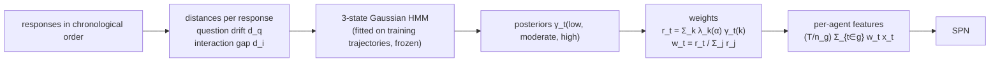

# CHMM situational weighting

A SAUP-inspired way to aggregate an agent's uncertainty over the rounds of the **feedback loop**. Instead of
weighting every response equally (RMS), each response is weighted by how much it deviates from the task, as
inferred by a hidden Markov model over two situational distances. Star and Sequential have one response per
agent, so they do not use it ([methods](methods.md)).



## 1. Situational distances

For every response t (`spuma/chmm/distances.py`):

| Distance | Compares | Missing when |
|---|---|---|
| **Question drift** d_q(t) | the original question with response t | never |
| **Interaction gap** d_i(t) | response t with the latest earlier response by a **different** agent (in the feedback loop: the other agent's last turn) | the first response, which has no earlier response by another agent |

Both are in [0, 1], higher = more deviation. The default estimator (`chmm.distance.estimator: qa`) uses the extractive
question-answering model [`deepset/roberta-base-squad2`](https://huggingface.co/deepset/roberta-base-squad2):
- **Reading the response:** the model reads response t as context for the original question, in sliding windows
  of 384 tokens with stride 128. In each window it compares the best answer span with its "no answer" option.
- **p_answerable(t)** = max over windows of sigmoid(s_best_span − s_null), with s = start logit + end logit.
- **d_q(t) = 1 − p_answerable(t):** the response no longer contains an answer to the question.
- **d_i(t) = 1 − F1(span_t, span_previous):** SQuAD token F1 between the two responses' best answer spans, i.e. how
  much they disagree on the answer.

These are proxies, since question-answering confidence is not a semantic distance. A model-free `lexical`
estimator (word coverage and Jaccard overlap) is also available. Distances are computed once and cached in
`scored-<fp>/chmm_distances-<fp>.json`.

## 2. Hidden Markov model

- **Model:** `hmmlearn.GaussianHMM` with 3 states, diagonal covariances, 200 EM iterations, `random_state = 42`
  (`spuma/chmm/hmm.py`).
- **Input:** x_t = [d_q(t), d_i(t)], standardized with a scaler fitted on the training trajectories.
- **Fitting:** on the **training** trajectories only, one sequence per trajectory (sequence boundaries preserved),
  then frozen.
- **Missing interaction gap:** filled with the training mean gap (which standardizes to 0), since hmmlearn cannot
  integrate a value out.
- **State ordering:** states are sorted by deviation (the mean of a state's standardized means), so states 0/1/2
  are always **low / moderate / high** deviation.
- **Posteriors:** γ_t(k) = P(S_t = k | x_1:T), by forward-backward (`predict_proba`).

## 3. Weights

Fixed, monotone state coefficients, never learned from correctness labels:

```text
λ(α) = [1, 1 + α, 1 + 2α]          α ∈ {0.5, 1, 2, 4}, primary α = 1
r_t  = Σ_k λ_k(α) γ_t(k)
w_t  = r_t / Σ_j r_j               (Σ_t w_t = 1 over the trajectory)
```

With α = 0 every weight is equal. That's checked by a unit test but isn't an evaluated configuration. Every
evaluation checks that the weights sum to 1 and that λ matches the formula and the trained model.

## 4. Per-agent features

For an agent g with n_g responses among the trajectory's T responses, each metric x ∈ {SE, MCSP, NLL, length}
becomes:

```text
feature_g(x) = (T / n_g) · Σ_{t ∈ g} w_t x_t
```

- **Equal weights:** this is exactly the agent's mean.
- **Unequal weights:** responses the HMM finds more deviant count more, within an agent and relative to the other
  agent.

The 8 features (solver and reviewer × 4 metrics) go to one SPN per α.

## Outputs

`chmm-<fp>/` contains:
- **`chmm.json`:** the fitted model in state order (start probabilities, transition matrix, means and variances
  in distance units, the missing-gap fill, convergence) and λ.
- **`steps.jsonl`:** each response's distances, posteriors and weights.
- **`diagnostics.json`:** where the weights go (by role, first/final response, answer corrections, disagreement,
  uncertainty).
