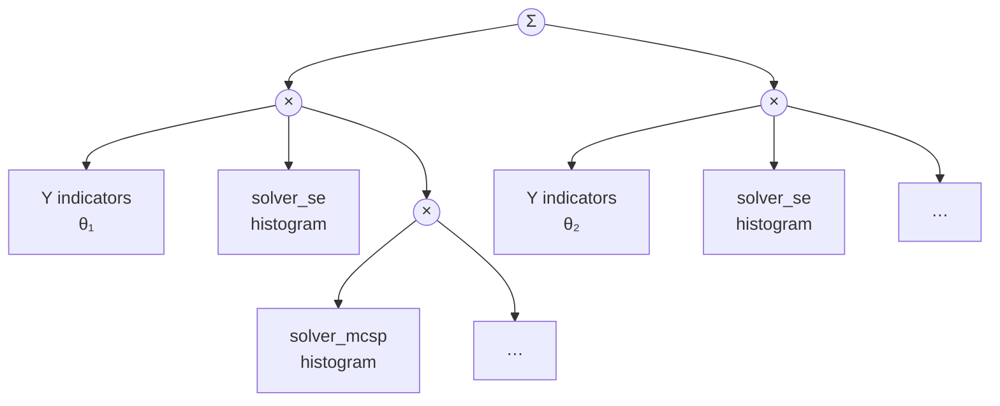
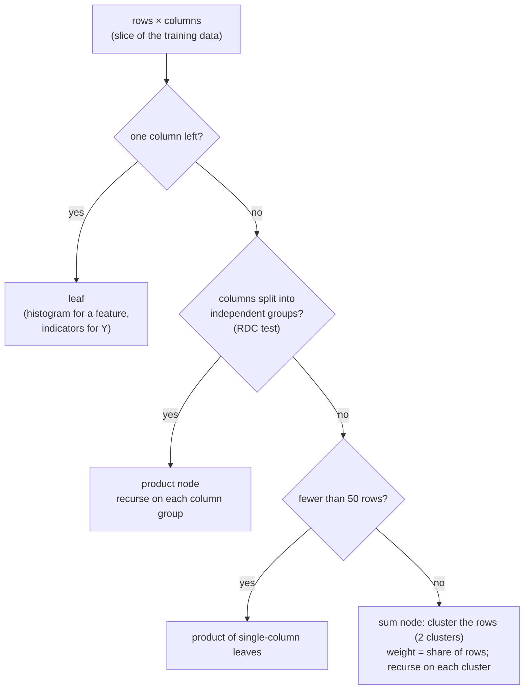

# Sum-product network (SPN)

SPUMA's learned uncertainty score is a **joint sum-product network** over the uncertainty features Z and the
correctness label Y (Y = 1: the final answer is wrong). It turns a feature vector into the probability that the
answer is wrong, **P(wrong | Z)**, and the posterior entropy of that prediction.

- **Implementation:** `spuma/spn/` (`model.py`: `JointSPN`; `leaves.py`: the label and histogram leaves;
  `config.py`: the `spn:` settings)
- **Library:** [SPFlow](https://github.com/SPFlow/SPFlow) (LearnSPN structure learning, log-space inference)

## What an SPN is

An SPN is a rooted graph that represents a probability distribution exactly:

| Node | Computes | Meaning |
|---|---|---|
| **Leaf** | a univariate distribution over one variable | a density of one feature, or the distribution of Y |
| **Product** | the product of its children, over disjoint sets of variables | those variable groups are independent here |
| **Sum** | a weighted sum of its children (weights sum to 1), over the same variables | a mixture: different clusters of problems |

Because products only combine disjoint variables and sums only mix children over the same variables, the network
is a valid distribution. Any joint or marginal probability is computed in one bottom-up pass.

## Joint model of features and label

`JointSPN` learns **one** network over the columns [Z, Y]:



*An illustrative structure. The actual one is learned from the training data and differs per method and dataset.*

Y is one binary variable with two indicator leaves, S(y) = θ · [Y = 1] + (1 − θ) · [Y = 0]. With that, every
query the method needs is exact:

```text
log P(Z, Y = c) = log S(Z, I(+y) = [c = 1], I(−y) = [c = 0])
log P(Z)        = log S(Z, I(+y) = 1, I(−y) = 1)                 (Y marginalized)
P(wrong | Z)    = P(Z, Y = 1) / ( P(Z, Y = 0) + P(Z, Y = 1) )
H(Y | Z)        = −p ln p − (1 − p) ln(1 − p),   p = P(wrong | Z)
```

- **P(wrong | Z)** is the method's risk score and probability (used for all six evaluation metrics).
- **H(Y | Z)**, the posterior entropy, is highest when the SPN cannot decide (p ≈ 0.5). It's reported as a
  separate ranking score.
- **Missing features:** a feature given as NaN is integrated out exactly, as for Y.

## Structure learning (LearnSPN)

Learned on the **training split only**, from the standardized features and the label:



- **Independence test:** the Randomized Dependence Coefficient (RDC). Columns are split into groups when their
  dependence is below the threshold 0.3.
- **Constant columns** (e.g. SE = 0 for every row of a slice) are split off as independent before the RDC test,
  which cannot handle zero variance.
- **The label stays connected:** while Y still varies within a slice, it is never split into a group of its own.
  It joins the feature it depends on most, so that P(Y | Z) can depend on Z everywhere in the network.
- **Deterministic:** structure learning is seeded (`spn.seed: 42`).

## Leaves

**Label leaf** (`BinaryIndicatorLeaf`): θ is the share of wrong answers among the training rows that reach the
leaf, Laplace-smoothed with pseudo-count 1 (`spn.prior_smoothing`).

**Feature leaves** (`HistogramLeaf`, `spn.leaf: histogram`): a piecewise-constant density per feature:
- **Bins:** 10 bins of equal width (`strategy: uniform`) between the feature's minimum and maximum over the full
  training data, after standardization.
- **Smoothing:** each bin's probability is Laplace-smoothed (pseudo-count 1), so no bin has density 0.
- **Tails:** two exponential tails beyond the training range, so a test value outside it gets a small, non-zero
  density instead of 0.

Gaussian (`normal`) and Laplace (`laplace`) leaves are also available.

## Inputs per architecture

The same SPN, with the same settings, is trained once per SPN method. Only its input differs (details in
[scores per architecture](methods.md)):

| Architecture | SPN methods | Features |
|---|---|---|
| Feedback loop | RMS SPN, CHMM α = 0.5 / 1 / 2 / 4 SPN | 8: solver and reviewer × (SE, MCSP, NLL, length), RMS- or CHMM-aggregated over each agent's rounds |
| Star | SPN | 20: each of the five responses × (SE, MCSP, NLL, length), raw |
| Sequential | SPN | 12: each of the three agents × (SE, MCSP, NLL, length), raw |

Before learning, each feature is standardized with the training mean and standard deviation, which are saved
with the model and reused on the test split.

## Settings (`spn:`)

| Setting | Value | Role |
|---|---|---|
| `backend` | `spflow` | structure learning and inference library |
| `target` | `incorrect` | Y = 1 means the final answer is wrong |
| `leaf` | grid: `normal`, `histogram` | feature leaves (`histogram`, `normal`, `laplace`) |
| `histogram.bins` / `strategy` | 10 / `uniform` | histogram leaves |
| `histogram.smoothing` | grid: 1.0, 5.0 | histogram Laplace pseudo-count per cell |
| `min_instances_slice` | grid: 25, 50, 100 | below this many rows a slice is fully factorized |
| `min_features_slice` | 2 | the smallest column set that is still split |
| `n_clusters` | 2 | clusters per sum node |
| `rdc_threshold` | grid: 0.1, 0.2, 0.3, 0.4 | independence threshold of the RDC test |
| `variance_floor` | grid: 0.01, 0.1 | normal leaves keep σ² ≥ floor (standardized units; 0 = none) |
| `keep_label_dependence` | true | never split the varying label off on its own |
| `standardize` | true | standardize features with training statistics |
| `prior_smoothing` | 1.0 | Laplace pseudo-count of the label leaves |
| `seed` | 42 | structure-learning seed |

## Class-conditional SPN (`class_conditional_spn:`)

`ClassConditionalSPN` (`spuma/spn/model.py`) is a second risk model next to the joint SPN, which it leaves unchanged.
It learns **two independent SPNs**, one density per class, and combines them by Bayes' rule in log space:

```text
SPN_correct(Z) = P(Z | Y = 0)        SPN_wrong(Z) = P(Z | Y = 1)        π_c = n_c / n  (training split, unsmoothed)
log P(Z, Y = c) = log π_c + log SPN_c(Z)
P(wrong | Z)    = exp( log P(Z, 1) − logsumexp_c log P(Z, c) )
```

- **Same inputs and preprocessing** as the joint SPN: the same features per architecture (per agent / per response,
  not aggregated, for Star and Sequential), standardized with the training statistics, histogram edges from all
  training rows (so both classes share them). Every `spn:` setting not tuned below is reused.
- **Training:** each SPN is learned on its class's training rows only (LearnSPN, RDC partitioning with constant
  columns split off; no label column).
- **Regularization and tuning:** the same `spn:` grid as the joint SPN (variance floor for Gaussian leaves,
  Laplace smoothing for histogram leaves), selected on validation Brier (see [validation grid](#validation-grid)).
- **Methods:** with `enabled: true`, every SPN method `m` of the CHMM study (`spn`, `rms_spn`, `chmm_a<α>_spn`) gets
  `m_cc`, evaluated on the same test problems and bootstrap resamples; `evaluation.json` →
  `class_conditional_comparisons` and `results.md` hold the paired differences class-conditional − joint.
  The same model is also registered as risk model `spn_class_conditional` (`evaluation.risk_models`, `ood.risk_model`).

`class_conditional_spn: {enabled: true}` turns it on (default off; on in the experiment configs).

### Validation grid

`leaf`, `rdc_threshold`, `min_instances_slice`, `variance_floor` and `histogram.smoothing` take a value or a list.
With lists, `SPNConfig.candidates()` crosses leaf × `rdc_threshold` × `min_instances_slice` with that leaf's
regularizer (`variance_floor` for normal, `histogram.smoothing` for histogram, none for laplace): 48 candidates
with the experiment configs. Every candidate is fitted on the training split and the one with the **lowest
validation Brier score** is kept; the test split is used only for evaluation. The joint and the class-conditional
SPN search the same grid the same way, and every trial is recorded in `<method>_status.json` (`tuning`). Scalars
mean no tuning: the previous fixed settings are `leaf: histogram`, `smoothing: 1.0`, `min_instances_slice: 50`,
`rdc_threshold: 0.3`, `variance_floor: 0`. Without labeled validation rows the first candidate is used.

## Saved models

Each trained SPN is saved as `chmm-<fp>/models/<method>.pt`, holding the network, feature names, standardization
statistics and settings. Next to it, `<method>_status.json` records the training rows, the number of wrong answers,
the learned prior log P(Y) and the structure size (sums, products, leaves).

Loading a model never refits it. The [frozen protocol](evaluation.md#protocols) applies a source experiment's
saved SPNs to another dataset, after checking that the feature names match.
